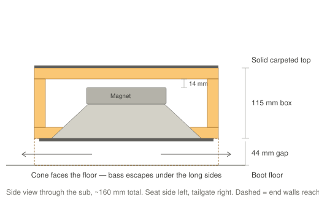
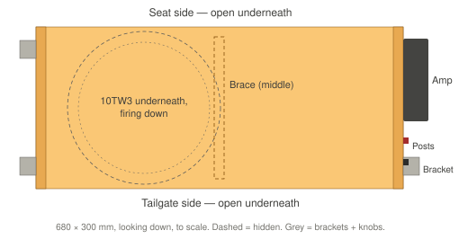
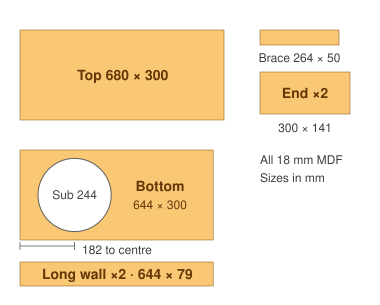
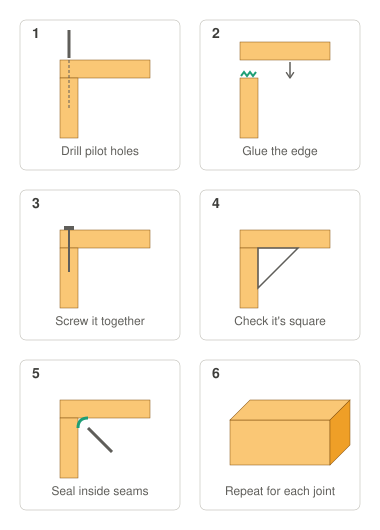
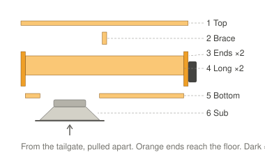
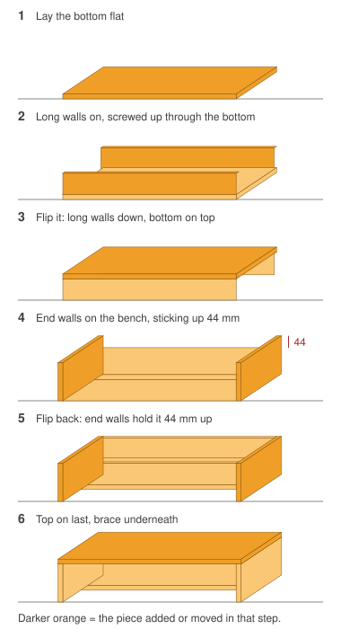
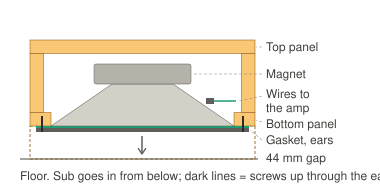
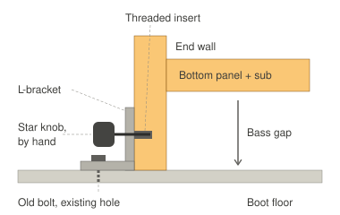
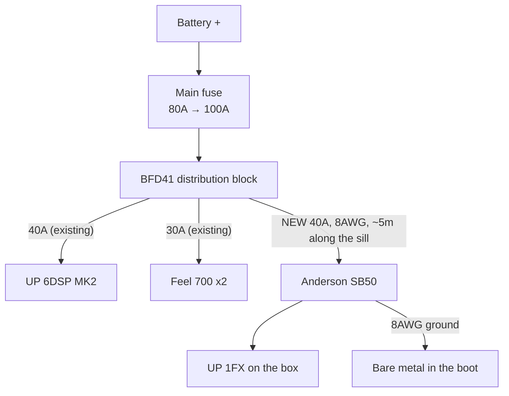
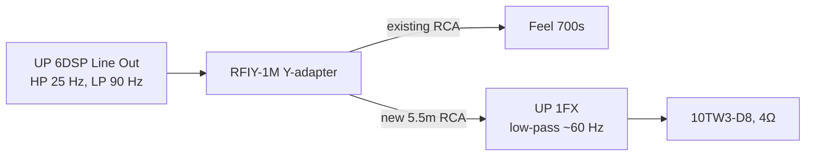

# Boot subwoofer — build plan

**Status: planned, parts not bought.**

One **JL Audio 10TW3-D8** in a home-built sealed box that replaces the boot compartment, driven by a
**Match UP 1FX** mounted on the end of the box. The sub fires **down** at the floor, so the top is
solid and carpeted: nothing on show, and shopping goes straight on top. The two Feel 700s stay under
the front seats for upper bass; the 10" adds the deep bass they can't reach (they stop at 40 Hz).

| | |
|---|---|
| Sub | JL Audio 10TW3-D8, coils wired to 4Ω |
| Amp | Match UP 1FX, 350W at 4Ω, on the box's end wall |
| Box | 680 × 300 × 159 mm (+ ~50 mm for the amp), 18 mm MDF, ~12.7 L inside |
| Fixing | Brackets on the old compartment's bolts + hand-turned knobs. No new holes, no tools to remove |
| Cost | ≈ £883, plus tools if not owned |

**Why this amp:** it has its own **low-pass filter**, so the 10" takes only the deep bass and leaves
the upper bass and punch to the Feel 700s. It's also the cheaper of the two Match options. At
46 × 130 × 153 mm it fits on the box's 159 mm-tall end wall standing on its 130 mm edge, so there's
no need to find a place for it in the boot, and the sub and amp come out together. The smaller
alternative is at the end: [Other amp option](#other-amp-option--match-m-21amp).

---

## Phase 1 — build the box and fix it down

Build and fit the empty box first. Only buy the sub and amp once the box fits and holds down well.
Steps 0–4 and 9 of the build; carpet, sub, amp and wiring come later.

| Shop | Item | Price |
|---|---|---|
| Wickes | [18 mm MDF, 606 × 1829 mm](https://www.wickes.co.uk/General-Purpose-MDF-Sheet---18-x-606-x-1829mm/p/207740) — ask them to cut the panels | ~ |
| Wickes | [30 × 30 × 3 mm steel angle](https://www.wickes.co.uk/Rothley-30mm-Hot-Rolled-Steel-Angle---1m/p/188290) — brackets | ~ |
| Screwfix | [Gorilla PVA wood glue](https://www.screwfix.com/p/gorilla-glue-wood-glue-236ml/43424) | £7.69 |
| Screwfix | [TurboGold screw pack (4 × 40 mm)](https://www.screwfix.com/p/turbogold-pz-double-countersunk-woodscrew-handy-pack-380-pieces/459jj) | £9.99 |
| Screwfix | [Clear silicone](https://www.screwfix.com/p/no-nonsense-general-purpose-silicone-clear-310ml/35887) | £4.79 |
| Screwfix | [Easyfix M8 tee nuts, 10](https://www.screwfix.com/p/easyfix-4-pronged-tee-nuts-m8-x-11mm-10-pack/47225) | £2.69 |
| Screwfix | [120 grit sanding sheets](https://www.screwfix.com/p/essentials-120-grit-multi-material-sanding-sheets-280mm-x-230mm-10-pack/209jg) | £3.98 |
| Screwfix | [Titan 600W jigsaw](https://www.screwfix.com/p/titan-ttb1471jsw-600w-electric-jigsaw-240v/135AN) *(tool)* | £23.99 |
| Screwfix | [Bosch T101AO jigsaw blades](https://www.screwfix.com/p/bosch-t101ao-wood-jigsaw-blades-83mm-5-pack/36303) *(tool)* | £5.99 |
| Screwfix | [Erbauer brad point wood bits, 3–10 mm](https://www.screwfix.com/p/erbauer-straight-shank-double-flute-brad-point-wood-drill-bit-set-8-pieces/793PH) *(tool)* | £8.99 |
| Screwfix | [Erbauer countersink](https://www.screwfix.com/p/erbauer-dra46881-hex-shank-wood-135-countersink-9-5mm-x-45mm-with-65mm-pilot-drill/86156) *(tool)* | £4.79 |
| Screwfix | [Magnusson hacksaw](https://www.screwfix.com/p/magnusson-24tpi-multi-material-hacksaw-12-300mm-/4686v) *(tool)* | £11.98 |
| Screwfix | [3M P2 dust masks, 5](https://www.screwfix.com/p/3m-8822-cool-flow-disposable-valved-masks-p2-5-pack/449ej) *(tool)* | £16.99 |
| RS | [M8 star knobs, 10](https://uk.rs-online.com/web/p/clamping-knobs/0686632) | £32.96 |
| RS | [HSS metal drill set, 1–10 mm](https://uk.rs-online.com/web/p/drill-bit-sets/6734709) *(tool)* — holes in the steel brackets | £47.15 |

**Screwfix ≈ £102, RS ≈ £80 — about £182**, plus the Wickes items. Skip any *(tool)* already owned.

- **Leave the sub hole uncut for now if you like** — cut it once the box fits; it's easy to do last.
- **Speaker wires** (build step 4.6) can go in later through the sub hole.
- The metal drill set is the cheapest way to get an 8.5 mm bit — RS only sells that size singly in
  boxes of 10 (£49). It also covers whatever size the old compartment bolts turn out to be.

---

## 1. The box

- **Sub in the bottom panel, firing down**, 200 mm from one end. Magnet points up inside the box.
- **End walls run to the floor**, holding the box 44 mm up. The long sides are open underneath —
  that's where the bass comes out. Keep those openings clear.
- **Brace** under the middle of the top, so it doesn't flex under load.
- **Amp** on the end wall away from the sub, on rubber washers, with air around it — no carpet
  over it.

Design based on [Audio Intensity's down-fire 10TW3 box](https://audiointensity.com/products/performance-optimized-down-fire-sealed-10-enclosure-jl-audio-10tw3-d4),
which uses the same 44 mm floor gap but is too big for this boot.

---

## 2. Build it

### Step 0 — Cardboard mock-up

Before cutting any MDF, tape cardboard into a 680 × 300 × 159 mm box (plus ~50 mm at one end for
the amp) and try it in the car:

- [ ] Fits the space with the compartment out
- [ ] Rear seats fold and lock back up
- [ ] Tailgate shuts
- [ ] Lifts out easily to reach the tools
- [ ] Shopping on top — height feels right

### Step 1 — Cut the panels

One [Wickes 18 mm MDF sheet, 606 × 1829 mm](https://www.wickes.co.uk/General-Purpose-MDF-Sheet---18-x-606-x-1829mm/p/207740)
does everything. Ask Wickes to cut it to size if you can — straight cuts make an airtight box.

| # | Part | Size (mm) | Qty |
|---|---|---|---|
| 1 | Top | 680 × 300 | 1 |
| 2 | Brace | 264 × 50 | 1 |
| 3 | End walls | 300 × 141 | 2 |
| 4 | Long walls | 644 × 79 | 2 |
| 5 | Bottom | 644 × 300 | 1 |

### Step 2 — Cut the sub hole in the bottom panel

1. **Mark the centre:** 182 mm from one end, 150 mm from either long edge.
2. **Draw the circle:** a strip of scrap wood with a screw at one end as the pivot and a pencil hole
   **122 mm** away. Swing it round — that's the 244 mm hole.
3. **Drill a starter hole** just inside the line, big enough for the jigsaw blade.
4. **Cut slowly** with the jigsaw (T101AO blade), staying just inside the line.
5. **Sand up to the line** until the sub drops in. Practise on an offcut first.

### Step 3 — How every joint is made

**Glue and screws, never nails.** The glue makes it strong and airtight; the screws hold it while
the glue dries.

1. **Drill** a 4 mm hole through the outer panel and countersink it. Then a 3 mm pilot into the
   middle of the other panel's edge — MDF splits without it.
2. **Glue** a bead along the edge.
3. **Screw** with 4 × 40 mm screws, every 100–150 mm, at least 25 mm from the ends.
4. **Check it's square**, wipe off squeeze-out.

### Step 4 — Put it together

Numbers match the cut list. Two flips, no blocks, top panel last:

1. **Bottom (5) flat** on the bench.
2. **Long walls (4) onto the bottom.** Stand each long wall on a long edge of the bottom panel,
   flush with the outside. Glue and screw up through the bottom into the wall.
3. **Flip it** so the long walls sit on the bench and the bottom panel is on top.
4. **End walls (3) on each end**, standing on the bench. They cover the ends of the long walls and
   stick up **44 mm past the bottom panel**. Glue and screw through them into the long walls and
   the bottom panel.
5. **Flip it back.** The end walls now hold the box 44 mm off the bench — this is the right way up.
6. **Speaker wires:** drill a small hole in the end wall away from the sub hole, where the amp will
   go. Push two short 12AWG wires through, run them inside to where the sub's terminals will be,
   with slack. Seal the hole with silicone.
7. **Brace (2) onto the top (1)** — on edge, across the middle, 340 mm from the sub end (half the box length). Glue and
   screw down through the top into it.
8. **Top on**, brace inside. Glue and screw into all four walls.
9. **Seal:** once the glue's dry, silicone every inside seam — reach in through the sub hole.

### Step 5 — Leak test

Push the sub into the hole (not screwed yet) and shine a torch inside in a dark garage — light at a
seam means a leak. Or once the sub is fitted, gently press the cone in: it should come back slowly.

### Step 6 — Carpet

- **Sides and ends:** the [ACV black carpet](https://caraudiodirect.co.uk/products/acv-30-1231-04-black-carpet-70cm-x-140cm),
  spray adhesive. On the long sides, stop at the bottom panel's edge — **don't cover the openings**.
  Leave the amp's patch of end wall bare.
- **Top:** reuse the **thick carpet from the old compartment lid** — it matches the boot and takes
  wear. Peel it off carefully (a hairdryer softens old glue), clean the back, and fit it **last** so
  it overlaps the side carpet. You need about 71 × 32 cm.
- Run foam strip along the bottom of the end walls to stop buzzing on the floor.

### Step 7 — Fit the sub

1. Box **upside down**.
2. **Foam strip** round the hole on the outside face — the gasket.
3. **Connect the wires:** both coils in parallel, + to +, − to − (that makes 4Ω).
4. **Lower the sub in**, magnet first. Screw up through the tab ears with **4 × 25 mm pan-head screws** (not countersunk), pilot
   holes first. Don't overtighten — the ears can crack.
5. Flip it back over. The sub can come out later the same way without opening the box.

### Step 8 — Fit the amp

1. Screw the UP 1FX to the end wall on its two mounting plates, **standing on its 130 mm edge**
   (fins vertical), with rubber washers behind it. Leave the controls facing out.
2. Connect the sub wires to its speaker output, + to +, − to −.
3. Fit an **Anderson SB50** on the power and ground leads, so the box unplugs in one go — see
   below.

#### How the Anderson plug works

It isn't a usual car audio part — most installs wire the amp in permanently. It's a heavy-duty DC
power connector (used on winches, caravans and battery packs). Here it lets the amp's power come
off with the box, with no tools.

- **Two identical halves** — one on the car side (power and ground from the front), one on the amp
  side. They push together and click; pull straight apart to separate.
- **One plug carries both wires** — red +12V and black ground. Rated 50A; the amp draws about 30A.
- **Fitting:** crimp or solder a contact onto each 8AWG wire and push it into the housing until it
  clicks. The fuse stays at the BFD41 as normal.
- **Unplug with the stereo off** so it doesn't spark.

**Simpler alternative:** skip it and wire the amp in permanently. Getting the box out then means
undoing the amp's two power screws with a screwdriver and doing them up again — fine if the jack is
only needed now and then, but it loses the "no tools" goal.

### Step 9 — Fix it in the car

1. **Remove the old compartment** and keep every bolt.
2. **Brackets:** cut short pieces of the steel angle with the hacksaw. Drill one hole to match the
   old bolt and one 8.5 mm hole in the upright for the knob. Bolt them to the floor with the **old
   bolts in the old holes**. One per end minimum, two per end if the holes allow.
3. **Tee nuts:** drop the box in place and mark through each bracket's knob hole onto the end wall.
   That spot is in the 44 mm gap below the bottom panel, so the inside face is reachable from
   underneath. Drill straight through to fit the tee nut's barrel (usually 10 mm — check it against
   the nut), then tap the M8 tee nut in from the **inside** face so its prongs bite.
4. **Knobs:** screw an M8 star knob through each bracket into its tee nut, hand tight. Tightening
   pulls the nut into the wood, so it can't come loose.

**To reach the tools:** undo the knobs, unplug the Anderson plug, the RCA and the remote wire, lift
the box out.

---

## 3. Wiring

### Power

Uses the **spare output on the existing BFD41** — no new connection at the battery.

- **8AWG power and ground, 40A fuse.** Match's manual asks for 25–35 mm² (4–2AWG) on runs over
  1 m, but that's sized for full power into 1–2Ω (up to 60A). Into 4Ω at 350W the amp draws about
  30A, where 8AWG loses ~0.3V over this run — fine. 4AWG wouldn't fit the Anderson SB50 (6AWG max),
  and 8AWG matches the other branches and the BFD41's 8AWG adapters. 6AWG is the step up if a
  shop has it.
- **Main fuse 80A → 100A.** Adding the amp takes the worst case past 80A. Real music draw is much
  lower, but 80A would blow first.
- **Ground:** its own short run to sanded bare metal in the boot, through the SB50 plug.
- **Afterwards:** voltage-drop test with everything playing hard — under 0.2V from each amp's
  ground to battery negative. Lights dimming on heavy bass → do the Big 3 (alternator is 75A).

### Signal

The UP 6DSP's one line out is **split** with a Y-adapter: one side to the Feel 700s (as now), the
other to the boot amp. Both subs share the DSP's sub channel, so the URC.3 knob still turns them
both up and down.

**Remote:** a ~1 mm² wire from the 6DSP's REM OUT to the amp, alongside the power, with a bullet
connector at the box.

### Tuning

| Where | Setting |
|---|---|
| DSP Line Out | High-pass 30 → **25 Hz** (this also protects the 10"); low-pass 90 Hz as now |
| UP 1FX | Bandpass mode, low-pass **~60 Hz**, RCA range jumper on **0.5–3V** (the line out is 3V) |
| Feel 700s | Gain down a little |

1. **Level:** amp gain from minimum, up until the 10" just matches the Feel 700s.
2. **Polarity:** there's no phase switch. Play a 40–60 Hz tone, swap the two speaker wires at the
   amp, play again. Keep the **louder** one.
3. **Rattles:** slow 25–80 Hz sweep, parked. Fix with deadening squares and felt tape.

---

## 4. Parts list

Prices checked October 2026. **~** = price not shown online. Wire lengths are estimates — run a
string along the route first.

### Sub, amp and wiring

| Item | Qty | Price |
|---|---|---|
| [JL Audio 10TW3-D8 — Audio Visual World](https://audiovisualworld.co.uk/jl-audio-10tw3-d8-shallow-mount-10-dual-8-ohm-car-subwoofer.html) | 1 | £399.99 |
| [Match UP 1FX — CEN](https://www.cen.uk/products/match-up-1fx-amp-mono-1-channel-subwoofer-amplifier-class-d-900w-rms-at-1-ohms) | 1 | £259.99 |
| [Powerbass XWS-8P 8AWG power — Car Audio Security](https://www.caraudiosecurity.com/products/xws-8p-8-awg-power-wire-per-metre-100-ofc-wire) | ~5m | £22.45 |
| [Powerbass XWS-8G 8AWG ground — Car Audio Security](https://www.caraudiosecurity.com/products/xws-8g-8-awg-ground-wire-per-metre-100-ofc-wire) | 1m | £4.49 |
| [Connection SFA-040 40A fuse](https://caraudiodirect.co.uk/products/connection-by-audison-sfa-040-40a-afs-fuses) — new BFD41 branch | 1 | £7.99 |
| [Connection SFA-100 100A main fuse](https://caraudiodirect.co.uk/products/connection-by-audison-sfa-100-100a-afs-fuses) | 1 | £7.99 |
| [Connection FRT8 8AWG ring terminals](https://caraudiodirect.co.uk/products/connection-frt8-8-gauge-ring-terminals) | 1 pack | £4.99 |
| [Anderson SB50 connector — RS](https://uk.rs-online.com/web/p/battery-connectors/6120150) — two make one plug + socket | 2 | £16.46 |
| [Connection SL212.2 12AWG speaker cable](https://caraudiodirect.co.uk/products/connection-by-audison-sl212-2-silver-series-high-resolution-12-gauge-speaker-cable-per-metre) | ~1m | £5.50 |
| [Rockford Fosgate RFIY-1M Y-adapter](https://caraudiodirect.co.uk/products/rfiy-1m-twisted-pair-y-adapter-1-male-to-2-female) | 1 | £9.99 |
| [Connection FT2-550.2 5.5m RCA](https://caraudiodirect.co.uk/products/connection-ft2-550-2-5-5m-rca-cable) | 1 | £15.99 |
| ~1 mm² remote wire — **already owned** | ~5m | — |
| **Subtotal** | | **£755.83** |

### Box and fixing

| Item | Qty | Price |
|---|---|---|
| [Wickes 18 mm MDF, 606 × 1829 mm](https://www.wickes.co.uk/General-Purpose-MDF-Sheet---18-x-606-x-1829mm/p/207740) | 1 | ~ |
| [Gorilla PVA wood glue — Screwfix](https://www.screwfix.com/p/gorilla-glue-wood-glue-236ml/43424) | 1 | £7.69 |
| [TurboGold screw pack (4 × 40 mm) — Screwfix](https://www.screwfix.com/p/turbogold-pz-double-countersunk-woodscrew-handy-pack-380-pieces/459jj) | 1 | £9.99 |
| [Clear silicone — Screwfix](https://www.screwfix.com/p/no-nonsense-general-purpose-silicone-clear-310ml/35887) | 1 | £4.79 |
| [ACV black carpet 70 × 140 cm](https://caraudiodirect.co.uk/products/acv-30-1231-04-black-carpet-70cm-x-140cm) — sides and ends; top reuses the old lid carpet | 1 | £24.99 |
| [OB41 spray adhesive — Screwfix](https://www.screwfix.com/p/ob41-fast-tack-spray-adhesive-clear-500ml/524YE) — collect only, 18+ | 1 | £5.59 |
| [Stormguard foam strip — Screwfix](https://www.screwfix.com/p/stormguard-sureseal-3-self-adhesive-foam-draught-excluder-weatherstrips-black-7-5m-2-pack/493VV) — sub gasket, under the end walls | 1 | £6.19 |
| [Rothley 30 × 30 × 3 mm steel angle — Wickes](https://www.wickes.co.uk/Rothley-30mm-Hot-Rolled-Steel-Angle---1m/p/188290) — cut into brackets | 1 | ~ |
| [M8 star knobs, pack of 10 — RS](https://uk.rs-online.com/web/p/clamping-knobs/0686632) | 1 | £32.96 |
| [Easyfix M8 tee nuts, 10 — Screwfix](https://www.screwfix.com/p/easyfix-4-pronged-tee-nuts-m8-x-11mm-10-pack/47225) — for the knobs | 1 | £2.69 |
| [Screw-Tite pan head screws 4 × 25 mm, 200 — Screwfix](https://www.screwfix.com/p/screw-tite-tfstpz4025-pz-pan-self-drilling-multi-purpose-screws-4mm-x-25mm-200-pack/415va) — sub tab ears (flat-underside head, not countersunk) | 1 | £5.79 |
| [Timco rubber washers M6 × 28 mm, 75 — Screwfix](https://www.screwfix.com/p/timco-rubber-sela-washers-m6-x-28mm-75-pack/1120x) — behind the amp's mounting plates | 1 | £15.49 |
| [RS PRO M8 external tooth washers, 100 — RS](https://uk.rs-online.com/web/p/washers/0276897) — ground point | 1 | £7.19 |
| [Essentials 120 grit sanding sheets, 10 — Screwfix](https://www.screwfix.com/p/essentials-120-grit-multi-material-sanding-sheets-280mm-x-230mm-10-pack/209jg) — sub hole, ground point to bare metal | 1 | £3.98 |
| Old compartment bolts — reused for the brackets | — | — |
| **Subtotal** | | **£127.34** |

**Already owned:** Vibe bullet connectors (remote wire at the box), sound deadening and Tesa fleece
tape (rattles), crimping tool.

**Total ≈ £883**, plus the MDF and steel angle (prices not shown online).

### Tools

| Item | Price |
|---|---|
| [Titan 600W jigsaw — Screwfix](https://www.screwfix.com/p/titan-ttb1471jsw-600w-electric-jigsaw-240v/135AN) — comes with a wood and a metal blade | £23.99 |
| [Bosch T101AO blades — Screwfix](https://www.screwfix.com/p/bosch-t101ao-wood-jigsaw-blades-83mm-5-pack/36303) — clean curves for the sub hole | £5.99 |
| [Erbauer brad point bits, 3–10 mm — Screwfix](https://www.screwfix.com/p/erbauer-straight-shank-double-flute-brad-point-wood-drill-bit-set-8-pieces/793PH) — includes the 10 mm for the tee nuts | £8.99 |
| [Erbauer countersink — Screwfix](https://www.screwfix.com/p/erbauer-dra46881-hex-shank-wood-135-countersink-9-5mm-x-45mm-with-65mm-pilot-drill/86156) | £4.79 |
| [Magnusson hacksaw — Screwfix](https://www.screwfix.com/p/magnusson-24tpi-multi-material-hacksaw-12-300mm-/4686v) — for the steel angle | £11.98 |
| [Magnusson hacksaw blades, 5 — Screwfix](https://www.screwfix.com/p/magnusson-hacksaw-blades-24tpi-12-5-pack/9262v) | £4.99 |
| [RS PRO HSS metal drill set — RS](https://uk.rs-online.com/web/p/drill-bit-sets/6734709) — or a single 8.5 mm HSS bit | £47.15 |
| [3M 8822 P2 dust masks, 5 — Screwfix](https://www.screwfix.com/p/3m-8822-cool-flow-disposable-valved-masks-p2-5-pack/449ej) — MDF dust | £16.99 |
| **Tools total** | **£124.87** |

### Shopping list by shop

The same parts, grouped so each shop is one order. *(tool)* = only if not already owned.

**Audio Visual World** — £399.99

| Item | Qty | Price |
|---|---|---|
| [JL Audio 10TW3-D8](https://audiovisualworld.co.uk/jl-audio-10tw3-d8-shallow-mount-10-dual-8-ohm-car-subwoofer.html) | 1 | £399.99 |

**CEN** — £259.99

| Item | Qty | Price |
|---|---|---|
| [Match UP 1FX](https://www.cen.uk/products/match-up-1fx-amp-mono-1-channel-subwoofer-amplifier-class-d-900w-rms-at-1-ohms) | 1 | £259.99 |

**Screwfix** — £139.92

| Item | Qty | Price |
|---|---|---|
| [Gorilla PVA wood glue](https://www.screwfix.com/p/gorilla-glue-wood-glue-236ml/43424) | 1 | £7.69 |
| [TurboGold screw pack (4 × 40 mm)](https://www.screwfix.com/p/turbogold-pz-double-countersunk-woodscrew-handy-pack-380-pieces/459jj) | 1 | £9.99 |
| [Clear silicone](https://www.screwfix.com/p/no-nonsense-general-purpose-silicone-clear-310ml/35887) | 1 | £4.79 |
| [OB41 spray adhesive](https://www.screwfix.com/p/ob41-fast-tack-spray-adhesive-clear-500ml/524YE) | 1 | £5.59 |
| [Stormguard foam strip](https://www.screwfix.com/p/stormguard-sureseal-3-self-adhesive-foam-draught-excluder-weatherstrips-black-7-5m-2-pack/493VV) | 1 | £6.19 |
| [Easyfix M8 tee nuts, 10](https://www.screwfix.com/p/easyfix-4-pronged-tee-nuts-m8-x-11mm-10-pack/47225) | 1 | £2.69 |
| [Screw-Tite pan head screws 4 × 25 mm, 200](https://www.screwfix.com/p/screw-tite-tfstpz4025-pz-pan-self-drilling-multi-purpose-screws-4mm-x-25mm-200-pack/415va) | 1 | £5.79 |
| [Timco rubber washers M6 × 28 mm, 75](https://www.screwfix.com/p/timco-rubber-sela-washers-m6-x-28mm-75-pack/1120x) | 1 | £15.49 |
| [Essentials 120 grit sanding sheets, 10](https://www.screwfix.com/p/essentials-120-grit-multi-material-sanding-sheets-280mm-x-230mm-10-pack/209jg) | 1 | £3.98 |
| [Titan 600W jigsaw](https://www.screwfix.com/p/titan-ttb1471jsw-600w-electric-jigsaw-240v/135AN) *(tool)* | 1 | £23.99 |
| [Bosch T101AO blades](https://www.screwfix.com/p/bosch-t101ao-wood-jigsaw-blades-83mm-5-pack/36303) *(tool)* | 1 | £5.99 |
| [Erbauer brad point bits, 3–10 mm](https://www.screwfix.com/p/erbauer-straight-shank-double-flute-brad-point-wood-drill-bit-set-8-pieces/793PH) *(tool)* | 1 | £8.99 |
| [Erbauer countersink](https://www.screwfix.com/p/erbauer-dra46881-hex-shank-wood-135-countersink-9-5mm-x-45mm-with-65mm-pilot-drill/86156) *(tool)* | 1 | £4.79 |
| [Magnusson hacksaw](https://www.screwfix.com/p/magnusson-24tpi-multi-material-hacksaw-12-300mm-/4686v) *(tool)* | 1 | £11.98 |
| [Magnusson hacksaw blades, 5](https://www.screwfix.com/p/magnusson-hacksaw-blades-24tpi-12-5-pack/9262v) *(tool)* | 1 | £4.99 |
| [3M 8822 P2 dust masks, 5](https://www.screwfix.com/p/3m-8822-cool-flow-disposable-valved-masks-p2-5-pack/449ej) *(tool)* | 1 | £16.99 |

**RS** — £103.76

| Item | Qty | Price |
|---|---|---|
| [Anderson SB50 connector](https://uk.rs-online.com/web/p/battery-connectors/6120150) | 2 | £16.46 |
| [M8 star knobs, pack of 10](https://uk.rs-online.com/web/p/clamping-knobs/0686632) | 1 | £32.96 |
| [RS PRO M8 external tooth washers, 100](https://uk.rs-online.com/web/p/washers/0276897) | 1 | £7.19 |
| [RS PRO HSS metal drill set](https://uk.rs-online.com/web/p/drill-bit-sets/6734709) *(tool)* | 1 | £47.15 |

**Car Audio Direct** — £77.44

| Item | Qty | Price |
|---|---|---|
| [Connection SFA-040 40A fuse](https://caraudiodirect.co.uk/products/connection-by-audison-sfa-040-40a-afs-fuses) | 1 | £7.99 |
| [Connection SFA-100 100A main fuse](https://caraudiodirect.co.uk/products/connection-by-audison-sfa-100-100a-afs-fuses) | 1 | £7.99 |
| [Connection FRT8 8AWG ring terminals](https://caraudiodirect.co.uk/products/connection-frt8-8-gauge-ring-terminals) | 1 pack | £4.99 |
| [Connection SL212.2 12AWG speaker cable](https://caraudiodirect.co.uk/products/connection-by-audison-sl212-2-silver-series-high-resolution-12-gauge-speaker-cable-per-metre) | ~1m | £5.50 |
| [Rockford Fosgate RFIY-1M Y-adapter](https://caraudiodirect.co.uk/products/rfiy-1m-twisted-pair-y-adapter-1-male-to-2-female) | 1 | £9.99 |
| [Connection FT2-550.2 5.5m RCA](https://caraudiodirect.co.uk/products/connection-ft2-550-2-5-5m-rca-cable) | 1 | £15.99 |
| [ACV black carpet 70 × 140 cm](https://caraudiodirect.co.uk/products/acv-30-1231-04-black-carpet-70cm-x-140cm) | 1 | £24.99 |

**Car Audio Security** — £26.94

| Item | Qty | Price |
|---|---|---|
| [Powerbass XWS-8P 8AWG power](https://www.caraudiosecurity.com/products/xws-8p-8-awg-power-wire-per-metre-100-ofc-wire) | ~5m | £22.45 |
| [Powerbass XWS-8G 8AWG ground](https://www.caraudiosecurity.com/products/xws-8g-8-awg-ground-wire-per-metre-100-ofc-wire) | 1m | £4.49 |

**Wickes** — prices not shown online; pay in store

| Item | Qty | Price |
|---|---|---|
| [Wickes 18 mm MDF, 606 × 1829 mm](https://www.wickes.co.uk/General-Purpose-MDF-Sheet---18-x-606-x-1829mm/p/207740) | 1 | ~ |
| [Rothley 30 × 30 × 3 mm steel angle](https://www.wickes.co.uk/Rothley-30mm-Hot-Rolled-Steel-Angle---1m/p/188290) | 1 | ~ |

**Everything, including tools: ≈ £1008**, plus the Wickes MDF and steel angle.

Audio Visual World and Car Audio Security are single-purpose orders on purpose: the 10TW3-D8 is
out of stock at CEN and Car Audio Direct only lists the D4, and none of the other shops sell 8AWG
OFC by the metre (only as complete amp kits).

---

## 5. Still to find out

Once the old compartment is out, in one go:

- [ ] Exact width wall to wall (the box plus amp needs ~730 mm), and is ~160 mm height OK?
- [ ] Do the tools sit under the floor (box lifts off them) or inside the compartment (they'd need a
      new home)?
- [ ] Old compartment bolts: how many, where, thread size, threaded holes or nuts underneath
- [ ] A bare-metal ground point near the box
- [ ] Power route from the BFD41 to the boot, and its real length

---

## Other amp option — Match M 2.1AMP

[Match M 2.1AMP — £369.99 at CEN](https://www.cen.uk/products/match-m-2-1-amp-micro-amplifier-mono-subwoofer-mode-or-2-channel-stereo-350w-rms).

- **Better:** much smaller (35 × 85 × 110 mm), so it sticks out only ~40 mm and the box can be 5 mm
  longer.
- **Worse:** £110 more, and **no low-pass filter** — the 10" plays the whole sub range alongside the
  Feel 700s instead of just the deep bass.
- **Changes:** use the [10TW3-D4](https://caraudiodirect.co.uk/products/jl-audio-10tw3-d4-500w-10-25cm-subwoofer-bass-driver)
  (£409, coils in parallel = 2Ω, 350W) instead of the D8. It's in mono mode from the factory; set the
  gain by its LED (radio ~90%, pink noise: down until green, up until orange, back to green). Same
  8AWG and 40A fuse. About **£968** in total.
