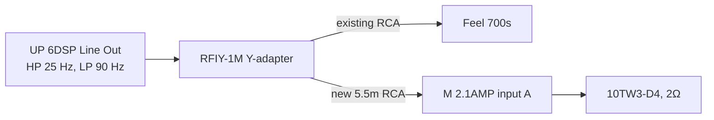

# Boot subwoofer — build plan

**Status: planned, parts not bought.**

One **JL Audio 10TW3-D4** in a home-built sealed box that replaces the boot compartment, driven by a
**Match M 2.1AMP** mounted on the end of the box. The sub fires **down** at the floor, so the top is
solid and carpeted: nothing on show, and shopping goes straight on top. The two Feel 700s stay under
the front seats for upper bass; the 10" adds the deep bass they can't reach (they stop at 40 Hz).

| | |
|---|---|
| Sub | JL Audio 10TW3-D4, coils wired to 2Ω |
| Amp | Match M 2.1AMP, 350W at 2Ω, on the box's end wall |
| Box | 685 × 300 × 159 mm, 18 mm MDF, ~12.8 L inside |
| Fixing | Brackets on the old compartment's bolts + hand-turned knobs. No new holes, no tools to remove |
| Cost | ≈ £968, plus tools if not owned |

**Why this amp:** it's small enough (35 × 85 × 110 mm) to live on the box itself, so there's no
need to find a place for an amp in the boot, and the sub and amp come out together. The trade-off:
it has no low-pass filter, so the 10" plays the whole sub range alongside the Feel 700s rather than
just the deepest notes. That's how most systems run — the DSP still cuts everything above 90 Hz.
The alternative with a filter is at the end: [Other amp option](#other-amp-option--match-up-1fx).

---

## 1. The box

- **Sub in the bottom panel, firing down**, 200 mm from one end. Magnet points up inside the box.
- **End walls run to the floor**, holding the box 44 mm up. The long sides are open underneath —
  that's where the bass comes out. Keep those openings clear.
- **Brace** under the middle of the top, so it doesn't flex under load.
- **Amp** on the end wall away from the sub, on rubber washers, with air around it — no carpet
  over it.

Design based on [Audio Intensity's down-fire 10TW3 box](https://audiointensity.com/products/performance-optimized-down-fire-sealed-10-enclosure-jl-audio-10tw3-d4),
which uses the same 44 mm floor gap but is too big for this boot.

---

## 2. Build it

### Step 0 — Cardboard mock-up

Before cutting any MDF, tape cardboard into a 685 × 300 × 159 mm box (plus ~40 mm at one end for
the amp) and try it in the car:

- [ ] Fits the space with the compartment out
- [ ] Rear seats fold and lock back up
- [ ] Tailgate shuts
- [ ] Lifts out easily to reach the tools
- [ ] Shopping on top — height feels right

### Step 1 — Cut the panels

One [Wickes 18 mm MDF sheet, 606 × 1829 mm](https://www.wickes.co.uk/General-Purpose-MDF-Sheet---18-x-606-x-1829mm/p/207740)
does everything. Ask Wickes to cut it to size if you can — straight cuts make an airtight box.

| # | Part | Size (mm) | Qty |
|---|---|---|---|
| 1 | Top | 685 × 300 | 1 |
| 2 | Brace | 264 × 50 | 1 |
| 3 | End walls | 300 × 141 | 2 |
| 4 | Long walls | 649 × 79 | 2 |
| 5 | Bottom | 649 × 300 | 1 |

### Step 2 — Cut the sub hole in the bottom panel

1. **Mark the centre:** 182 mm from one end, 150 mm from either long edge.
2. **Draw the circle:** a strip of scrap wood with a screw at one end as the pivot and a pencil hole
   **122 mm** away. Swing it round — that's the 244 mm hole.
3. **Drill a starter hole** just inside the line, big enough for the jigsaw blade.
4. **Cut slowly** with the jigsaw (T101AO blade), staying just inside the line.
5. **Sand up to the line** until the sub drops in. Practise on an offcut first.

### Step 3 — How every joint is made

**Glue and screws, never nails.** The glue makes it strong and airtight; the screws hold it while
the glue dries.

1. **Drill** a 4 mm hole through the outer panel and countersink it. Then a 3 mm pilot into the
   middle of the other panel's edge — MDF splits without it.
2. **Glue** a bead along the edge.
3. **Screw** with 4 × 40 mm screws, every 100–150 mm, at least 25 mm from the ends.
4. **Check it's square**, wipe off squeeze-out.

### Step 4 — Put it together

Numbers match the cut list. Build it **upside down on a flat floor**, top panel last:

1. **Long walls (4) onto the bottom (5).** Stand each long wall on a long edge of the bottom panel,
   flush with the outside. Glue and screw up through the bottom into the wall.
2. **End walls (3) on each end.** They cover the ends of the long walls and the bottom panel, and
   hang **44 mm below the bottom panel**. Tip: put two 44 mm-thick offcuts under the bottom panel
   while you fix the ends — it sets the gap for you.
3. **Speaker wires:** drill a small hole in the end wall away from the sub hole, where the amp will
   go. Push two short 12AWG wires through, run them inside to where the sub's terminals will be,
   with slack. Seal the hole with silicone.
4. **Brace (2) onto the top (1)** — on edge, across the middle, 340 mm from the sub end. Glue and
   screw down through the top into it.
5. **Top on**, brace inside. Glue and screw into all four walls.
6. **Seal:** once the glue's dry, silicone every inside seam — reach in through the sub hole.

### Step 5 — Leak test

Push the sub into the hole (not screwed yet) and shine a torch inside in a dark garage — light at a
seam means a leak. Or once the sub is fitted, gently press the cone in: it should come back slowly.

### Step 6 — Carpet

- **Sides and ends:** the [ACV black carpet](https://caraudiodirect.co.uk/products/acv-30-1231-04-black-carpet-70cm-x-140cm),
  spray adhesive. On the long sides, stop at the bottom panel's edge — **don't cover the openings**.
  Leave the amp's patch of end wall bare.
- **Top:** reuse the **thick carpet from the old compartment lid** — it matches the boot and takes
  wear. Peel it off carefully (a hairdryer softens old glue), clean the back, and fit it **last** so
  it overlaps the side carpet. You need about 72 × 32 cm.
- Run foam strip along the bottom of the end walls to stop buzzing on the floor.

### Step 7 — Fit the sub

1. Box **upside down**.
2. **Foam strip** round the hole on the outside face — the gasket.
3. **Connect the wires:** both coils in parallel, + to +, − to − (that makes 2Ω).
4. **Lower the sub in**, magnet first. Screw up through the tab ears with **flat-head screws**, pilot
   holes first. Don't overtighten — the ears can crack.
5. Flip it back over. The sub can come out later the same way without opening the box.

### Step 8 — Fit the amp

1. Screw the M 2.1AMP to the end wall on its own mounting plates, **standing on its 85 mm edge**,
   with rubber washers behind it.
2. Connect the sub wires to its speaker output. It's in **mono mode** from the factory — leave the
   jumper in.
3. Fit an **Anderson SB50** on the power and ground leads, so the box unplugs in one go.

### Step 9 — Fix it in the car

1. **Remove the old compartment** and keep every bolt.
2. **Brackets:** cut short pieces of the steel angle with the hacksaw. Drill one hole to match the
   old bolt and one 8.5 mm hole in the upright for the knob. Bolt them to the floor with the **old
   bolts in the old holes**. One per end minimum, two per end if the holes allow.
3. **Inserts:** drop the box in place and mark through each bracket's knob hole onto the end wall.
   Drill 11 mm, about 13 mm deep, and screw in the M8 insert with an 8 mm hex key.
4. **Knobs:** screw an M8 star knob through each bracket into its insert, hand tight.

**To reach the tools:** undo the knobs, unplug the Anderson plug, the RCA and the remote wire, lift
the box out.

---

## 3. Wiring

### Power

Uses the **spare output on the existing BFD41** — no new connection at the battery.

- **8AWG** power and ground. Match ask for 6 mm² minimum; 8AWG is 8.4 mm². It fits the BFD41
  through one of its 8AWG adapters.
- **Main fuse 80A → 100A.** Adding the amp takes the worst case past 80A. Real music draw is much
  lower, but 80A would blow first.
- **Ground:** its own short run to sanded bare metal in the boot, through the SB50 plug.
- **Afterwards:** voltage-drop test with everything playing hard — under 0.2V from each amp's
  ground to battery negative. Lights dimming on heavy bass → do the Big 3 (alternator is 75A).

### Signal

The UP 6DSP's one line out is **split** with a Y-adapter: one side to the Feel 700s (as now), the
other to the boot amp. Both subs share the DSP's sub channel, so the URC.3 knob still turns them
both up and down.

**Remote:** a ~1 mm² wire from the 6DSP's REM OUT to the amp, alongside the power, with a bullet
connector at the box.

### Tuning

| Where | Setting |
|---|---|
| DSP Line Out | High-pass 30 → **25 Hz** (this also protects the 10"); low-pass 90 Hz as now |
| M 2.1AMP | Radio at ~90%, pink noise: gain down until the LED is green, up until orange, back to green |
| Feel 700s | Gain down a little |

1. **Level:** bring the amp up until the 10" just matches the Feel 700s.
2. **Polarity:** there's no phase switch. Play a 40–60 Hz tone, swap the two speaker wires at the
   amp, play again. Keep the **louder** one.
3. **Rattles:** slow 25–80 Hz sweep, parked. Fix with deadening squares and felt tape.

---

## 4. Parts list

Prices checked October 2026. **~** = price not shown online. Wire lengths are estimates — run a
string along the route first.

### Sub, amp and wiring

| Item | Qty | Price |
|---|---|---|
| [JL Audio 10TW3-D4 — Car Audio Direct](https://caraudiodirect.co.uk/products/jl-audio-10tw3-d4-500w-10-25cm-subwoofer-bass-driver) | 1 | £409.00 |
| [Match M 2.1AMP — CEN](https://www.cen.uk/products/match-m-2-1-amp-micro-amplifier-mono-subwoofer-mode-or-2-channel-stereo-350w-rms) | 1 | £369.99 |
| [Powerbass XWS-8P 8AWG power — Car Audio Security](https://www.caraudiosecurity.com/products/xws-8p-8-awg-power-wire-per-metre-100-ofc-wire) | ~5m | £22.45 |
| [Powerbass XWS-8G 8AWG ground — Car Audio Security](https://www.caraudiosecurity.com/products/xws-8g-8-awg-ground-wire-per-metre-100-ofc-wire) | 1m | £4.49 |
| [Connection SFA-040 40A fuse](https://caraudiodirect.co.uk/products/connection-by-audison-sfa-040-40a-afs-fuses) — new BFD41 branch | 1 | £7.99 |
| [Connection SFA-100 100A main fuse](https://caraudiodirect.co.uk/products/connection-by-audison-sfa-100-100a-afs-fuses) | 1 | £7.99 |
| [Connection FRT8 8AWG ring terminals](https://caraudiodirect.co.uk/products/connection-frt8-8-gauge-ring-terminals) | 1 pack | £4.99 |
| [Anderson SB50 connector — RS](https://uk.rs-online.com/web/p/battery-connectors/6120150) — two make one plug + socket | 2 | £16.46 |
| [Connection SL212.2 12AWG speaker cable](https://caraudiodirect.co.uk/products/connection-by-audison-sl212-2-silver-series-high-resolution-12-gauge-speaker-cable-per-metre) | ~1m | £5.50 |
| [Rockford Fosgate RFIY-1M Y-adapter](https://caraudiodirect.co.uk/products/rfiy-1m-twisted-pair-y-adapter-1-male-to-2-female) | 1 | £9.99 |
| [Connection FT2-550.2 5.5m RCA](https://caraudiodirect.co.uk/products/connection-ft2-550-2-5-5m-rca-cable) | 1 | £15.99 |
| ~1 mm² remote wire — **already owned** | ~5m | — |
| **Subtotal** | | **£874.84** |

### Box and fixing

| Item | Qty | Price |
|---|---|---|
| [Wickes 18 mm MDF, 606 × 1829 mm](https://www.wickes.co.uk/General-Purpose-MDF-Sheet---18-x-606-x-1829mm/p/207740) | 1 | ~ |
| [Gorilla PVA wood glue — Screwfix](https://www.screwfix.com/p/gorilla-glue-wood-glue-236ml/43424) | 1 | £7.69 |
| [TurboGold screw pack (4 × 40 mm) — Screwfix](https://www.screwfix.com/p/turbogold-pz-double-countersunk-woodscrew-handy-pack-380-pieces/459jj) | 1 | £9.99 |
| [Clear silicone — Screwfix](https://www.screwfix.com/p/no-nonsense-general-purpose-silicone-clear-310ml/35887) | 1 | £4.79 |
| [ACV black carpet 70 × 140 cm](https://caraudiodirect.co.uk/products/acv-30-1231-04-black-carpet-70cm-x-140cm) — sides and ends; top reuses the old lid carpet | 1 | £24.99 |
| [OB41 spray adhesive — Screwfix](https://www.screwfix.com/p/ob41-fast-tack-spray-adhesive-clear-500ml/524YE) — collect only, 18+ | 1 | £5.59 |
| [Stormguard foam strip — Screwfix](https://www.screwfix.com/p/stormguard-sureseal-3-self-adhesive-foam-draught-excluder-weatherstrips-black-7-5m-2-pack/493VV) — sub gasket, under the end walls | 1 | £6.19 |
| [Rothley 30 × 30 × 3 mm steel angle — Wickes](https://www.wickes.co.uk/Rothley-30mm-Hot-Rolled-Steel-Angle---1m/p/188290) — cut into brackets | 1 | ~ |
| [M8 star knobs, pack of 10 — RS](https://uk.rs-online.com/web/p/clamping-knobs/0686632) | 1 | £32.96 |
| [M8 threaded inserts for wood — Fusion Fixings](https://fusionfixings.co.uk/products/m8-x-25mm-type-d-threaded-insert-nut-yellow-zinc) | 4 | £1.12 |
| Bolts, nyloc nuts, washers — match the old compartment's bolts | — | ~ |
| **Subtotal** | | **£93.32** |

**Total ≈ £968**, plus the MDF, steel angle and bolts.

### Tools

| Item | Price |
|---|---|
| [Titan 600W jigsaw — Screwfix](https://www.screwfix.com/p/titan-ttb1471jsw-600w-electric-jigsaw-240v/135AN) — comes with a wood and a metal blade | £23.99 |
| [Bosch T101AO blades — Screwfix](https://www.screwfix.com/p/bosch-t101ao-wood-jigsaw-blades-83mm-5-pack/36303) — clean curves for the sub hole | £5.99 |
| [Erbauer brad point bits, 3–10 mm — Screwfix](https://www.screwfix.com/p/erbauer-straight-shank-double-flute-brad-point-wood-drill-bit-set-8-pieces/793PH) | £8.99 |
| [Erbauer countersink — Screwfix](https://www.screwfix.com/p/erbauer-dra46881-hex-shank-wood-135-countersink-9-5mm-x-45mm-with-65mm-pilot-drill/86156) | £4.79 |
| [DeWalt 11 mm brad point bit — Rapid](https://rapidonline.com/catalogue/product/84-3574) — for the inserts | £3.29 |
| [Magnusson hacksaw — Screwfix](https://www.screwfix.com/p/magnusson-24tpi-multi-material-hacksaw-12-300mm-/4686v) — for the steel angle | £11.98 |
| [Magnusson hacksaw blades, 5 — Screwfix](https://www.screwfix.com/p/magnusson-hacksaw-blades-24tpi-12-5-pack/9262v) | £4.99 |
| [RS PRO HSS metal drill set — RS](https://uk.rs-online.com/web/p/drill-bit-sets/6734709) — or a single 8.5 mm HSS bit | £47.15 |
| Dust mask | — |
| **Tools total** | **£111.17** |

---

## 5. Still to find out

Once the old compartment is out, in one go:

- [ ] Exact width wall to wall (the box plus amp needs ~725 mm), and is ~160 mm height OK?
- [ ] Do the tools sit under the floor (box lifts off them) or inside the compartment (they'd need a
      new home)?
- [ ] Old compartment bolts: how many, where, thread size, threaded holes or nuts underneath
- [ ] A bare-metal ground point near the box
- [ ] Power route from the BFD41 to the boot, and its real length

---

## Other amp option — Match UP 1FX

[Match UP 1FX — £259.99 at CEN](https://www.cen.uk/products/match-up-1fx-amp-mono-1-channel-subwoofer-amplifier-class-d-900w-rms-at-1-ohms).
Worth it if a good spot for it turns up in the boot.

- **Better:** £110 cheaper; has a **low-pass filter** (50–250 Hz), so the 10" can take only the
  deepest notes and leave the upper bass to the Feel 700s; the box keeps its full 730 mm length
  (~13.7 L).
- **Worse:** 46 × 130 × 153 mm — too big for the box, so it needs a home on the car body in the
  boot, and none has been found.
- **Changes:** use the **10TW3-D8** (coils in parallel = 4Ω, 350W) instead of the D4; box 730 mm
  long (top 730, bottom and long walls 694); a **Speakon** socket on the box instead of the amp;
  bandpass mode with the low-pass at ~60 Hz.
- **Power wire:** Match recommend 25–35 mm² for runs over 1 m, which is aimed at full power into
  1–2Ω (60A). Into 4Ω at 350W it draws roughly 30A, so **8AWG would work** over ~5 m (about 0.3V
  drop) — but it's below Match's recommendation. **6AWG** is a sensible middle ground; 4AWG matches
  the manual. Use a 60A fuse.
- **Parts that change:** [10TW3-D8 — Audio Visual World](https://audiovisualworld.co.uk/jl-audio-10tw3-d8-shallow-mount-10-dual-8-ohm-car-subwoofer.html)
  £399.99, [Speakon socket](https://uk.rs-online.com/web/p/speaker-connectors/0464690) £3.70 and
  [plug](https://uk.rs-online.com/web/p/speaker-connectors/2843472) £7.12,
  [60A fuse](https://caraudiodirect.co.uk/products/connection-by-audison-sfa-060-60a-afs-fuses)
  £7.99. No Anderson plug. About **£850–£890** in total, depending on the wire.
