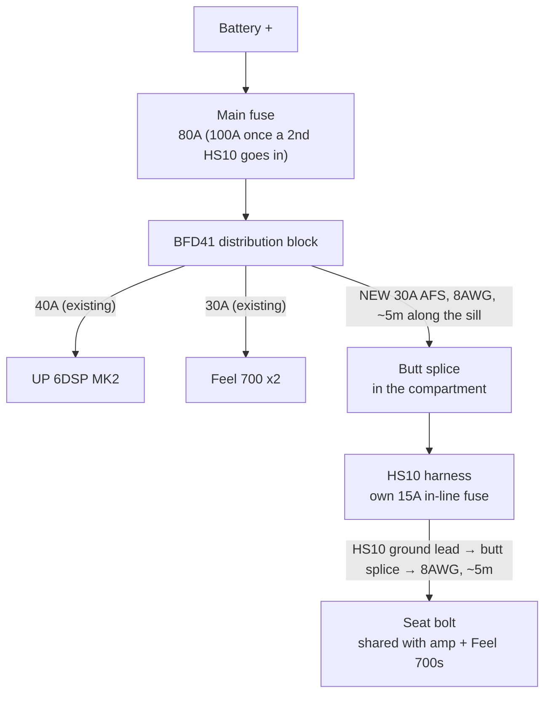

# Boot subwoofer — build plan

**Status: planned, parts not bought.**

One **Kicker Hideaway HS10** powered sub, hidden **inside the existing aluminium boot compartment**.
The compartment stays, the boot floor stays flat, and the tyre tools stay where they are. The two
Feel 700s stay under the front seats for upper bass; the 10" adds the deep bass they can't reach
(they stop at 40 Hz).

| | |
|---|---|
| Sub | Kicker HS10 (51HS10 / KA46HS10) — 10", built-in 180W RMS amp, rated 25–120 Hz |
| Size | 249 × 356 × 81 mm (one listing gives 381 mm long including the knob and harness) |
| Where | Inside the aluminium compartment, firing up, venting through the compartment's holes |
| Signal | Feel 700 #2's spare RCA out → 5.5 m RCA → Kicker KISL → HS10 low-level input |
| Power | Spare BFD41 way, 30A AFS, 8AWG along the sill; 8AWG ground back to the shared seat-bolt ground |
| Cost | ≈ £515 including a crimper |
| Later | A second HS10 alongside it — everything below is sized for two |

**Why this sub:** it's the only slim 10" from a brand worth trusting that fits the compartment. The
compartment is **28 cm front to back and ~10 cm tall inside**, but runs almost the full width of the
boot. The HS10 is 24.9 cm deep and 8.1 cm tall, so it drops in with ~3 cm and ~2 cm to spare. The
HS12 (30.8 cm deep) doesn't fit inside. Slim 10"s from other brands (Helix U 10A, Ground Zero
GZCS SW-1000A) are the same 150–220W class; at ~8 cm tall the box volume limits the deep bass more
than the amp does.

**Why not the old plan:** the previous plan here was a home-built down-firing box with a JL 10TW3
and a Match UP 1FX, replacing the compartment. Dropped — building the box is the hard part, and a
pro-made enclosure will do it better. It's in the git history if it's ever needed.

---

## The compartment

From the bottom up:

1. **Tool well** — a hole in the boot floor with the tyre tools in it
2. **Thin wooden lid** over the well
3. **Aluminium compartment**, ~10 cm tall, with a carpeted lid hinged at the seat end and two
   toggle latches at the tailgate end

The seat-side wall has **two rows of holes, backed with grey felt** — a row of larger ones (~6 cm)
and a row of smaller ones (~4–5 cm).

### Venting

Inside a closed compartment the sub would trap its own bass and its amp's heat. **Pull the felt out
of the holes** so the compartment breathes into the gap behind the seats.

- Rough target: open area of at least **~100 cm²** for one 10" (about a third of the cone's
  ~330 cm²). The lower row alone is roughly 8 × 16 cm² ≈ 130 cm² — sizes estimated from a photo.
- If it still sounds choked, open the larger row too.

### Reaching the tools

Open the aluminium lid, unplug the HS10's quick-connect harness, lift it out, lift the wooden lid.
Leave enough slack on the power, RCA and remote leads to lift the sub clear.

---

## Wiring

### Power

- **8AWG, 30A.** One HS10 draws 15A max; 8AWG and 30A are sized so a **second HS10** can share the
  same run later. The fuse protects the wire; each HS10 has its own 15A fuse in its harness.
- **Butt splice, not a block.** One 8AWG butt from the JTAREA kit joins the 8AWG to the HS10's power
  lead. For two HS10s later, twist both leads together into the same end. If they sit loose in the
  barrel, fold the stripped ends back to bulk them up. Adhesive heat shrink over it, zip-tied down.
  *Unknown: the gauge of the HS10's power lead — check when it arrives.*
- **Main fuse.** Worst case with one HS10: amp 35A + Feel 700s 28A + HS10 15A = **78A**, just under
  the 80A main fuse. A second HS10 takes it to 93A — swap to **100A** then (or now).
- **Ground: same seat bolt as the amp and Feel 700s, not the boot.** The RCA shield already ties
  the HS10's ground to Feel 700 #2's ground at that bolt; a second ground point in the boot would
  make a loop through the body — the usual cause of alternator whine. Run 8AWG back alongside the
  power, butt-spliced to the HS10's ground lead at the compartment, with its own 8AWG ring terminal
  stacked on the bolt (bare metal both faces). 8AWG so a second HS10 can share it.
- **Afterwards:** voltage-drop test with everything playing hard — under 0.2V from the HS10's
  ground to battery negative.

### Signal

- **Feel 700 #2's RCA out is free** — nothing uses it today. Taking the signal from there needs no
  Y-adapters at the amp, and the run from under the passenger seat to the boot is shorter than from
  the glovebox.
- **The KISL** turns RCA into the bare-wire input on the HS10's harness. It's two-channel: channel
  1 now, channel 2 ready for a second HS10. Kicker's own recommendation for RCA sources.
- **HS10 Input Level switch on LO** — that's its RCA-level range (250 mV–10 V); HI is for speaker
  level.
- *Unknown: whether the Feel 700's RCA out is a straight pass-through or comes after its own
  crossover and gain.* Test once wired: change the Feel 700s' gain and listen to whether the HS10
  changes too. If it does, the Feel gains need setting before the HS10's.

### Remote

One core of 18AWG cable (~6 m) from the 6DSP's **REM OUT** to the HS10's remote input, joined with a
bullet connector at the compartment. REM OUT already feeds Feel 700 #1 — branch from the same
terminal.

---

## Tuning

| Where | Setting |
|---|---|
| DSP Line Out | As now — feeds all the subs |
| Feel 700s | Gain down a little — they handle upper bass |
| HS10 | Input Level **LO**; low-pass ~60 Hz; bass boost off to start |

1. **Level:** HS10 gain from minimum, up until it fills in under the Feel 700s without booming.
2. **Phase:** the HS10 has a phase switch. Play a 40–60 Hz tone, try both, keep the **louder**.
3. **Rattles:** slow 25–80 Hz sweep, parked. The compartment lid and latches are the likely
   culprits — felt tape where metal meets metal.

---

## Parts list

Prices checked October 2026. Wire lengths are estimates — run a string along the route first.

### Car Audio Security — £480.36

| Item | Qty | Price |
|---|---|---|
| [Kicker HS10](https://www.caraudiosecurity.com/products/kicker-ka46hs10-10-hideaway-compact-powered-loaded-enclosure-180w-rms) | 1 | £399.99 |
| [Powerbass XWS-8P 8AWG power, 100% OFC](https://www.caraudiosecurity.com/products/xws-8p-8-awg-power-wire-per-metre-100-ofc-wire) — BFD41 → boot | ~5 m | £22.45 |
| [Powerbass XWS-8G 8AWG ground, 100% OFC](https://www.caraudiosecurity.com/products/xws-8g-8-awg-ground-wire-per-metre-100-ofc-wire) — boot → seat bolt | ~5 m | £22.45 |
| [Connection B218.2 18AWG cable](https://www.caraudiosecurity.com/products/b-218-18-gauge-speaker-cable) — remote wire, glovebox → boot (sold per metre; one core used) | ~6 m | £10.50 |
| [Vibe CLRT8-V7 8AWG ring terminals](https://www.caraudiosecurity.com/products/clrt8-v7-8-awg-ring-termainal-pack-of-1-pair) — HS10 ground at the seat bolt (hole size not listed — must fit the seat bolt) | 1 pair | £4.99 |
| [Phonocar 30A AFS fuse](https://www.caraudiosecurity.com/products/4-463-2-afs-fuses-30a) — spare BFD41 way | 1 | £4.99 |
| [Connection FT2 5.5 m RCA](https://www.caraudiosecurity.com/products/connection-by-audison-ft2-professional-grade-ft-series-rca-cable) — Feel 700 #2 → boot | 1 | £14.99 |

### Kicker UK — £17.95

| Item | Qty | Price |
|---|---|---|
| [Kicker KISL](https://kickeruk.com/products/kisl) — RCA to HS10 input, 2 channels | 1 | £17.95 |

**Already owned:** JTAREA butt connector kit, Vibe bullet connectors, adhesive heat shrink. The HS10 comes with its own fused power lead and ring terminals.

### Toolstation — £16.98

| Item | Qty | Price |
|---|---|---|
| [Heavy Duty Semi Ratchet Crimping Tool](https://www.toolstation.com/heavy-duty-semi-ratchet-crimping-tool/p42429) — for the JTAREA uninsulated butts and the 8AWG ring terminal; non-insulated copper terminals, 1.5–16 mm² (8AWG ≈ 8.4 mm²) | 1 | £16.98 |

**Total ≈ £515.**

### When the second HS10 goes in

| Item | Qty | Price |
|---|---|---|
| [Kicker HS10](https://www.caraudiosecurity.com/products/kicker-ka46hs10-10-hideaway-compact-powered-loaded-enclosure-180w-rms) | 1 | £399.99 |
| [Connection SFA-100.1 100A AFS main fuse](https://www.caraudiosecurity.com/products/sfa-100-100a-afs-fuses) | 1 | £7.00 |

Re-crimp the power splice two-into-one, use the KISL's second channel, and check the compartment
is at least ~80 cm long inside for two units plus cable room.

---

## Before buying

- [ ] **Compartment inside length** — at least ~40 cm for one HS10 with its harness (~80 cm for two)
- [ ] **Felt-backed holes go right through** to the seat side — peel one back to check
- [ ] **Ground route length** — compartment to the seat bolt
- [ ] **Seat bolt size** — so the Vibe ring terminal hole fits (not listed on the product page)
- [ ] **RCA route length** — passenger seat to the compartment; the FT2 only comes in 5.5 m here
