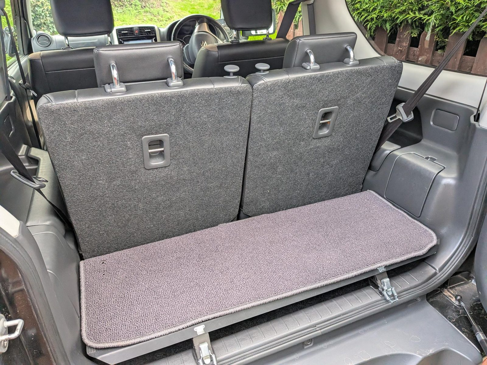
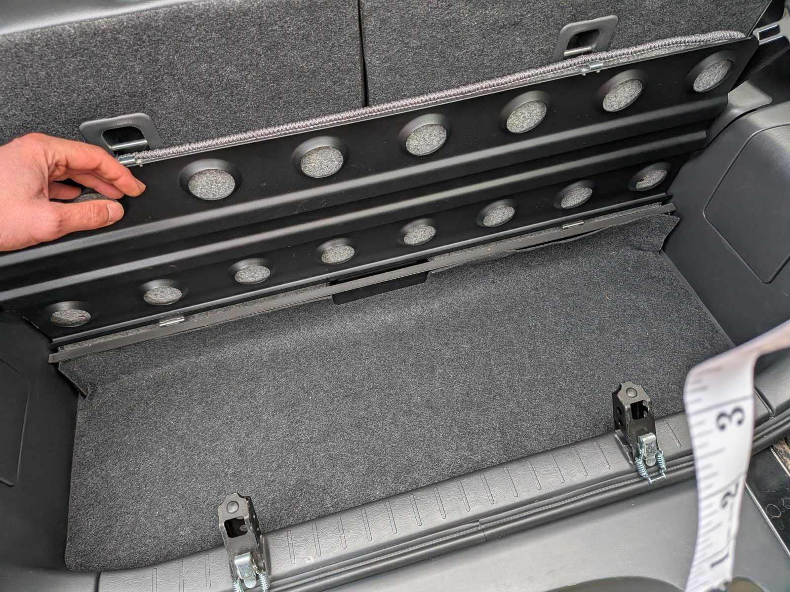
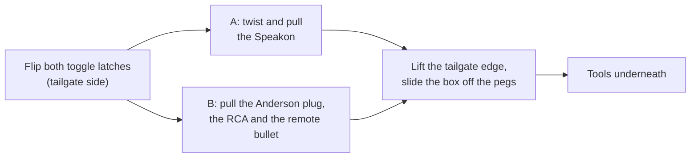
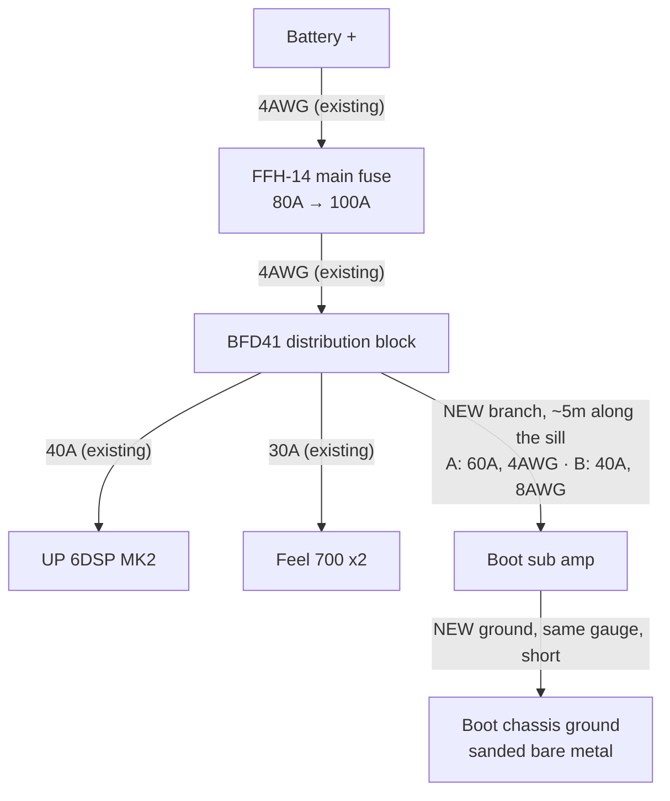
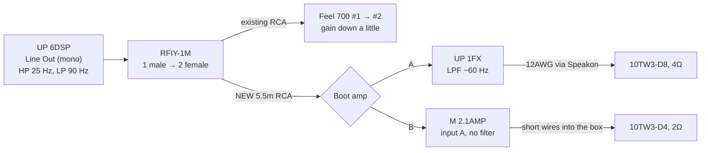

# Boot subwoofer — build plan

**Status: planned, parts not bought.** One JL Audio 10TW3 in a custom sealed, **down-firing** box
that replaces the boot compartment — the top is solid and carpeted, so the sub is completely hidden
and the box takes any load. The two Feel 700s stay under the front seats. **Two amp options** — the
sub, box and power feed are the same; what changes is where the amp lives and how the bass is split.

Hard constraints: **stealthy** (looks like a carpeted boot floor), **not in the way** (the rear seats
still fold and the boot still takes shopping, boxes and timber), and the **tools underneath stay
reachable without tools**.

## The two options

| | **A — Match UP 1FX, amp fixed in the car** | **B — Match M 2.1AMP, amp on the box** |
|---|---|---|
| Amp size | 46 × 130 × 153 mm — too big for the box | 35 × 85 × 110 mm — fits the box's end face |
| Power to the sub | 350W (10TW3-**D8**, 4Ω) | 350W (10TW3-**D4**, 2Ω) |
| Low-pass filter on the amp | **Yes**, 50–250 Hz | **No** |
| Bass split | 10" deep, Feel 700s upper bass | Both play the whole sub range |
| Where the amp goes | Somewhere on the body in the boot — **not found yet** | Box end — **solved** |
| Lifting the box out | 2 latches + 1 speaker plug | 2 latches + power plug + RCA + remote |
| Power wire to the boot | 4AWG, 60A branch | 8AWG, 40A branch — lighter, easier to route |
| Box | 730 mm long, ~13.7 L | ~685 mm long, ~12.8 L |
| Height, both | ~160 mm (end walls extend to the floor) | ~160 mm (end walls extend to the floor) |
| Price | £259.99 amp, **≈ £854 all-in** | £369.99 amp, **≈ £934 all-in** |

**A — pros:** cheapest; proper deep/upper split; simplest quick release; the box keeps all its air.
**A — cons:** needs a home for a 13 × 15 cm amp in the boot, and there isn't an obvious one.

**B — pros:** the amp problem goes away; thinner power wire; everything for the sub is one unit.
**B — cons:** £80 more; no low-pass, so the 10" also plays upper bass rather than leaving it to the
Feel 700s (this is how most systems run — the DSP still cuts everything above 90 Hz); four things
to undo to lift the box out instead of two; a little less air in the box.

**Leaning B** unless a good amp spot turns up in the boot — the location problem is the harder one.

### How the bass is split

| Job | Option A | Option B |
|---|---|---|
| ~25–40 Hz | 10" only | 10" only |
| ~40–60 Hz | 10" + Feel 700s | 10" + Feel 700s |
| ~60–90 Hz | Feel 700s (10" filtered out) | 10" + Feel 700s |
| 90 Hz up | MW4 kick panels | MW4 kick panels |

The Feel 700s only reach down to 40 Hz (Harman spec sheet), so in both options the 10" takes the
octave they can't play. Both subs share one DSP channel — see [Signal](#signal).

## The space

The boot has a lidded compartment with toggle latches, fitted by a previous owner. It isn't used,
so the box replaces it. The tools (jack, wheel brace, small bag) sit underneath.

| Compartment closed | Compartment open |
|---|---|
|  |  |

| Measurement | Value |
|---|---|
| Internal height (floor to underside of lid) | **~10 cm** |
| Front to back | **~30 cm** |
| Width | **at least ~73 cm** (the tape ran past 75 cm along the sill) |
| Top of the lid to the top of the folded-up rear seat | **~43 cm** |

## Ruled out

- **Kicker HS12 on the back of a rear seat** — over 8 cm thick, and with 43 cm from the lid to the
  seat top it only fits if the compartment comes out anyway.
- **10" subs under the front seats** in place of the Feel 700s — keeping them is cheaper and they
  still do the upper bass.
- **12"** — the frame alone is ~33 cm across; it can't fit 30 cm front to back.
- **Ported box** — needs more air than the space has.
- **Amp inside the box** — eats volume and needs its own sealed chamber.
- **Premium compact mono amps on the box** — Helix M ONE (230 × 154 mm), JL JD500/1 (251 × 191 mm)
  and Hertz HCP 1D (215 × 190 mm) all have a short side over 15 cm, so none fits the 11.5 cm box
  face. They'd work in option A's position if one is found.
- **Up-firing with a grille or steel plate on top** — works, but leaves a grille in the load floor to
  protect. Down-firing gives a solid top for ~3.5 cm more height.
- **Ready-made down-firing 10TW3 box** — [Audio Intensity's](https://audiointensity.com/products/performance-optimized-down-fire-sealed-10-enclosure-jl-audio-10tw3-d4)
  is 762 × 381 × 125 mm plus 44 mm feet: ~8 cm too deep for the 30 cm space, and US-only. Used
  below as the reference design.
- **M 2.1AMP plus an inline RCA low-pass** — the plug-in filters found (Harrison Labs FMOD) are
  fixed-frequency, a gentle 6 dB/octave, and US-only.

**Fallback if the box build stalls:** a [Kicker HS10](https://caraudiocentre.co.uk/products/kicker-ka51hs10-hs-10-hideaway-compact-powered-loaded-enclosure)
(£399.95, special order, 3–5 days) dropped into the existing compartment. 250 × 84 × 368 mm, so it
clears the 10 cm height; the perforated lid lets the bass out. Same class as a Feel 700 (180W RMS),
so more output but not deeper — the custom box is the real upgrade.

---

## The sub

**JL Audio 10TW3** — the D4 and D8 are the same sub with the same 400W rating and the same sound.
Only the coil impedance differs; pick the one that gives the amp the right load. Both coils are
joined + to +, − to − (parallel).

| Option | Version | Coils in parallel | Amp gives |
|---|---|---|---|
| A — UP 1FX | **10TW3-D8** | 4Ω | 350W (the D4 at 2Ω would get 600W — over the rating) |
| B — M 2.1AMP | **10TW3-D4** | 2Ω | 350W (the D8 at 4Ω would get only 210W) |

| Spec | Value |
|---|---|
| Power | 400W RMS |
| Overall diameter, across the tab ears | **284 mm** |
| Diameter between the tab ears | 267 mm |
| Cutout | **244 mm** |
| Mounting depth (from the top of the baffle) | **83 mm** |
| Clearance needed behind the magnet | 6 mm |
| Xmax | 15.2 mm one way |
| JL sealed box | 16.3 L net (0.575 cu ft) |

Use flat-head screws on the tab ears, not countersunk — JL warn countersunk screws can crack them.

## The box — down-firing

*Top view is option A. In option B the Speakon is replaced by the amp on the right-hand end face,
and the box is ~45 mm shorter to make room for it.*

The sub mounts in the **bottom** panel, cone facing the floor, magnet pointing up into the box.
The two **short end walls extend 44 mm below the bottom panel** and stand on the floor, so the cone
has room to breathe. The two long sides stay open underneath and the bass spills out there — in a
car, bass doesn't care which way the sub faces.

**Reference design:** [Audio Intensity's down-fire 10TW3 box](https://audiointensity.com/products/performance-optimized-down-fire-sealed-10-enclosure-jl-audio-10tw3-d4)
(US, $259.99). Too big for this space (762 × 381 × 125 mm), but it's the same idea built for the
same sub: 0.55 cu ft (15.6 L) net, 3/4" MDF, a double-thickness 1.5" baffle, and **1.75" (44 mm)
of floor clearance** — which is where the 44 mm gap here comes from. That box uses separate feet;
extended walls do the same job and are simpler (see Layout).

**Height.** Mounting depth is measured from the outside face of the baffle, so the magnet reaches
83 − 18 = 65 mm into the box. Add the 6 mm clearance and the minimum inside height is **71 mm**,
or **107 mm** outside with 18 mm top and bottom. The plan uses **115 mm** (79 mm inside) for more
air and a 14 mm gap above the magnet, **plus the 44 mm gap = ~160 mm total**.

**Volume.** Wider and taller is better; JL's figure is 16.3 L. Net figures below allow for the sub
(0.54 L) and one 18 × 50 mm brace. 30 cm front to back, 18 mm MDF:

| Outside width × height | Inside | Net air |
|---|---|---|
| 730 × 107 mm (minimum height) | 694 × 264 × 71 mm | 12.2 L |
| **730 × 115 mm (option A)** | **694 × 264 × 79 mm** | **13.7 L** |
| **685 × 115 mm (option B, amp on the end)** | **649 × 264 × 79 mm** | **12.8 L** |
| 730 × 125 mm | 694 × 264 × 89 mm | 15.5 L |
| 650 × 115 mm (if the tools need a bay) | 614 × 264 × 79 mm | 12.0 L |

Under 16.3 L the bass gets a little less deep and a little punchier. The Jimny's tiny cabin boosts
the lowest notes, which makes up for much of that. **Don't go under ~12 L** — so option B and a
tool bay together don't fit.

**Layout.**

- **Sub down-firing** in the bottom panel, centred front to back, ~200 mm in from one end. The tab
  ears land 8 mm from the front and back edges, so the 30 cm depth is used to the millimetre.
- **Extended end walls instead of feet** — cut the two short end walls **159 mm** tall (115 + 44)
  and fix the bottom panel between them 44 mm up. They stand on the floor and carry the load
  straight down; no separate feet to make or line up.
- **Long sides open underneath** — the seat-side and tailgate-side walls stop at the bottom panel,
  leaving two ~69 cm × 44 mm openings for the bass. Don't extend these instead: the ends sit close
  to the boot's side trims, so openings there would be choked. Don't let the carpet hang over the
  openings, and run foam strip under the end walls to stop buzzing.
- **Brace** — one strip of 18 mm MDF across the inside of the top panel, clear of the magnet. The
  top carries the load, so this matters more than before.
- **Optional:** a second layer of 18 mm MDF on the bottom panel around the sub (the reference box
  uses a 1.5" baffle). Stiffer, and it cuts the magnet's reach into the box to 47 mm.
- **The end away from the sub** carries the connection:
  - **A:** a Speakon socket — the box's terminal *and* its quick-disconnect.
  - **B:** the M 2.1AMP, standing on its 85 mm edge so it fits the 115 mm face, on its own mounting
    plates with rubber washers behind (the end face is 159 mm tall). Keep the carpet off it — it needs air. Speaker wires pass
    through a drilled hole into the box, sealed with silicone.
- **Joints** — glue and screw every joint, pilot holes first (MDF splits), silicone along every
  inside seam. Foam strip under the sub's flange as a gasket.
- **Carpet** the outside, spray adhesive, wrap the edges under — on the long sides, wrap to the
  bottom panel's edge so the openings stay clear.

### Down-firing, in practice

- **The top is solid** — shopping, boxes and timber go straight on the carpet. No grille to buy,
  fit or protect.
- **The cone faces the floor**, 44 mm above it, between the extended end walls. At full volume it moves 15 mm toward the floor,
  leaving ~29 mm. Nothing may sit under the box — the tools live under the floor board, not in
  the gap.
- **Crumbs and grit collect underneath.** Give it a clean when the box comes out for the tools.

### Ready-made boxes checked (October 2026)

Searched for a pre-built down-firing or slim sealed 10" box that fits **~730 × 300 mm and ~160 mm
tall**. Nothing UK-stocked fits; everything that comes close is US-only:

| Box | Outside size (W × D × H) | Verdict |
|---|---|---|
| [Audio Intensity down-fire, JL 10TW3](https://audiointensity.com/products/performance-optimized-down-fire-sealed-10-enclosure-jl-audio-10tw3-d4) — empty, $259.99 | 762 × 381 × 125 mm + 44 mm feet (1.75") | **~8 cm too deep.** The reference design. They list "custom build — contact us", so a 730 × 300 mm version could be asked for |
| [Zenclosures down-fire, JL 10TW3](https://www.zenclosures.com/JL-Audio-10tw3-d4-Subwoofer-Box-p/jlaudio10tw3df.htm) — empty, $184.99 | 559 × 343 × 178 mm | ~4 cm too deep, ~2 cm too tall |
| [DS18 EN-DF10](https://ds18.com/products/ds18-en-df10-10-shallow-subwoofer-enclosure-and-down-firing-design-300-watts) — loaded with a DS18 sub, 300W 4Ω, $239.95 | 515 × 295 × 160 mm | **Fits**, but a budget driver in place of the JL, and no UK stockist found |
| [Rockford Fosgate T1S-1X10](https://rockfordfosgate.com/products/details/t1s-1x10) — loaded, 500W 1Ω | 680 × 318 mm wedge, 108–159 mm | Built to stand behind a seat, not down-fire; 1Ω suits neither Match amp |
| JL CS110TG-TW3 / CS110LG-TW3 PowerWedges | 486–527 × 315–357 mm wedges, up to 165 mm | Wedges built to stand behind a seat; too deep laid flat |

**Building it is still the route.** If building feels like too much, the realistic alternatives are
asking Audio Intensity for a 730 × 300 mm version of their box (US shipping), or a local car audio
installer building it to the measurements in this plan.

### Cutting the 244 mm hole

- **Mark it:** strip of scrap wood, screw through one end at the centre, pencil hole 122 mm away,
  swing it round.
- **Cut it:** jigsaw — drill a starter hole inside the line and follow it slowly. Or the multi-tool,
  short overlapping plunge cuts just inside the line, then sand back.
- **Cut small, sand up** until the sub drops in. Practise on an offcut, test-fit before gluing.

---

## Quick release

No tools needed to reach the jack.

- **Seat side — pegs into a floor angle.** A steel angle bolts to the floor through the old
  compartment's bolt holes. Two short bolts sticking out of the box's seat-side face drop into
  holes in its upright. This stops the box sliding toward the seats under braking and stops that
  edge lifting.
- **Tailgate side — toggle latches.** **Reuse the compartment's own latches** if they line up —
  they're already bolted to the floor brackets. The tailgate face now starts 44 mm off the floor
  (the opening is below it), so the catch plates go low on that face, or on the ends of the
  extended end walls. Spare latches listed below if the old ones don't reach.
- **Anti-rattle** — foam strip on the angle and under the end walls. A 10" pushes enough air to buzz any
  hard contact.
- **A — the amp stays in the car.** Only the speaker lead crosses to the box, through the Speakon:
  a locking connector rated 40A, so it can't shake loose.
- **B — the amp lifts out with the box.** Power and ground go through one **Anderson SB50** (both
  wires in one plug, rated 50A; the amp draws 40A max). The RCA plugs straight into the amp, and
  the remote wire uses one of the Vibe bullet connectors already owned. Leave enough slack that
  the box lifts clear before anything pulls tight.

The latches and pegs together are what hold the box in a crash, so the floor angle must be steel,
bolted, not screwed into trim.

---

## Amp

### Option A — Match UP 1FX

**[£259.99 at CEN](https://www.cen.uk/products/match-up-1fx-amp-mono-1-channel-subwoofer-amplifier-class-d-900w-rms-at-1-ohms)**, in stock.

| Spec | Value |
|---|---|
| Power | **350W @ 4Ω**, 600W @ 2Ω, 900W @ 1Ω |
| Inputs | 1x RCA (0.5–3V or 1–6V), 2x high-level, REM in |
| Filters | Low-pass **50–250 Hz** (12 dB, bandpass mode), 15 Hz subsonic |
| Phase switch | **None** — flip polarity by swapping the speaker leads |
| Current | 60A RMS max at 12V; internal 2x 30A |
| Cable (manual) | 25–35 mm² for runs over 1 m |
| Size | 46 × 130 × 153 mm |

**Where it goes:** fixed to the body in the boot, not on the box — dry, with air around it, close
enough that the speaker lead to the Speakon is short. **No spot found yet** — see open questions.

### Option B — Match M 2.1AMP

**[£369.99 at CEN](https://www.cen.uk/products/match-m-2-1-amp-micro-amplifier-mono-subwoofer-mode-or-2-channel-stereo-350w-rms)**, in stock.

| Spec | Value |
|---|---|
| Power, mono mode | **350W @ 2Ω**, 210W @ 4Ω (up to 430W @ 2Ω) |
| Inputs | 2x RCA (1–6V) — **only input A is used in mono**; REM in |
| Filters | **None.** The manual says crossovers are set in the DSP ahead of it |
| Phase switch | None — swap speaker leads |
| Current | 40A RMS max at 12V; internal 30A |
| Cable (manual) | **6 mm² minimum** (4 mm² under 1 m) |
| Size | 35 × 85 × 110 mm |
| Mode | **Mono is the factory default** (jumper fitted); minimum 2Ω in mono |

Gain: set the radio to ~90% volume, play pink noise, turn gain down until the LED is green, up
until orange, then back to green (manual procedure).

Both amps: install somewhere dry with air circulation, and check behind any mounting surface for
cables, brake lines and the fuel tank before drilling.

---

## Power

Uses a **spare output on the existing BFD41**. The BFD41 has four outputs (one 2AWG, three 4AWG)
and only two are used — amp and sub branches. It came with four 8AWG adapters.

| Device | Max draw | Branch fuse |
|---|---|---|
| Match UP 6DSP | 35A | 40A (existing) |
| Feel 700 x2 | 28A | 30A (existing) |
| **A — Match UP 1FX** | **60A** (manual), ~30A at 350W into 4Ω (estimate) | **60A, new** |
| **B — Match M 2.1AMP** | **40A** (manual), ~30A at 350W into 2Ω (estimate) | **40A, new** |
| **Worst case on paper** | **A: 123A · B: 103A** | main **80A → 100A** |

- **Main fuse up to 100A** in both options. Today's 63A worst case sits on an 80A main; either amp
  takes the paper maximum past it. Real music draw is far lower than the maxima, but 80A would be
  the first thing to blow. The FFH-14 takes AFS fuses up to 300A and the main run is 4AWG.
- **Alternator is 75A** (DENSO DAN1007). Fine for listening with the engine running. Watch for
  lights dimming on heavy bass — if they do, the Big 3 is the next step, not a new alternator.
- **A — 4AWG OFC, power and ground.** Match recommend 25–35 mm² for the UP 1FX over 1 m at full
  power; 4AWG is ~21 mm². At 4Ω it draws about half its maximum, so 4AWG is comfortable over ~5 m,
  and it lands in a BFD41 4AWG port with no adapter.
- **B — 8AWG OFC, power and ground.** Match ask for 6 mm² minimum; 8AWG is 8.4 mm². It goes into the
  BFD41 through one of its 8AWG adapters and suits the Anderson SB50's contacts.
- **Ground** — its own short run, same gauge as the power, to sanded bare metal in the boot, ring
  terminal, star washer. Not shared with the front ground. In option B it goes through the SB50
  plug first.
- **Re-do the voltage-drop test** afterwards with everything playing hard: under 0.2V from each
  amp's ground to battery negative.

---

## Signal

The UP 6DSP has **one** line out, already feeding the Feel 700s. All seven DSP channels are used,
so the boot sub **shares** that output — no separate DSP EQ or time delay for it.

- **Split at the amp, not under the seats.** The RFIY-1M plugs into Line Out; the existing Feel 700
  RCA goes in one side, the new 5.5 m RCA in the other. One lead of each RCA is used, as now.
- **Remote:** a new ~1 mm² run from the 6DSP's REM OUT, alongside the power wire.
- **URC.3** keeps working — it sets Line Out level, so it turns both subs up and down together.
- **Subsonic:** the DSP's Line Out high-pass protects the 10" in both options — the M 2.1AMP has no
  filter of its own.

### Tuning

| Where | Option A | Option B |
|---|---|---|
| DSP Line Out I | High-pass 30 → **25 Hz**, low-pass **90 Hz** (unchanged) | Same |
| Boot amp | Bandpass mode, LPF **~60 Hz**, RCA range 0.5–3V | Mono mode (default), gain by the LED |
| Feel 700s | Gain down a little; LPF and bass boost as now | Same |

1. **Gain first:** boot amp gain at minimum, then up until the 10" just matches the Feel 700s.
2. **Polarity:** neither amp has a phase switch, so play a 40–60 Hz tone from the driver's seat,
   swap the two speaker wires at the amp and play it again. Keep whichever is **louder**.
3. **Rattles:** play a slow 25–80 Hz sweep parked. Expect the tailgate card, number plate, rear
   quarter trims and the dropped clip nuts in the kick panels. Deadening squares and felt tape.

---

## Parts list

Prices checked October 2026. **~** = price not shown on the page. Wire lengths are estimates —
run a string along the route before ordering.

### Option A only

| Item | Qty | Price |
|---|---|---|
| [JL Audio 10TW3-D8 — Audio Visual World](https://audiovisualworld.co.uk/jl-audio-10tw3-d8-shallow-mount-10-dual-8-ohm-car-subwoofer.html) — in stock | 1 | £399.99 |
| [Match UP 1FX — CEN](https://www.cen.uk/products/match-up-1fx-amp-mono-1-channel-subwoofer-amplifier-class-d-900w-rms-at-1-ohms) — in stock. Also [Dav-Tec](https://dav-tec.co.uk/product/match-up-1fx-amp-mono-1-channel-subwoofer-amplifier-class-d-900w-rms-at-1-ohms/) £259.00 | 1 | £259.99 |
| [Powerbass XWS-4P 4AWG power, 100% OFC](https://caraudiodirect.co.uk/products/powerbass-xws-4p-4-gauge-power-wire-100-ofc-wire-per-meter) — BFD41 → boot | ~5m @ £10.99 | £54.95 |
| [Powerbass XWS-4G 4AWG ground, 100% OFC](https://caraudiodirect.co.uk/products/powerbass-xws-4g-4-gauge-power-wire-100-ofc-wire-per-meter) | 1m | £10.99 |
| [Connection SFA-060 60A AFS](https://caraudiodirect.co.uk/products/connection-by-audison-sfa-060-60a-afs-fuses) — new BFD41 branch | 1 | £7.99 |
| [Vibe CLRT4-V7 4AWG ring terminals, pair](https://caraudiodirect.co.uk/products/vibe-clrt4-v7-critical-link-4-awg-ring-terminal-pair) — ground end | 1 | £4.99 |
| [Connection SL212.2 12AWG speaker cable](https://caraudiodirect.co.uk/products/connection-by-audison-sl212-2-silver-series-high-resolution-12-gauge-speaker-cable-per-metre) — amp → Speakon, plus inside the box | ~2m @ £5.50 | £11.00 |
| [Neutrik NL4MPXX Speakon panel socket — RS](https://uk.rs-online.com/web/p/speaker-connectors/0464690) — on the box | 1 | £3.70 |
| [Neutrik NL4FXX-W-S Speakon cable plug — RS](https://uk.rs-online.com/web/p/speaker-connectors/2843472) | 1 | £7.12 |
| **Subtotal** | | **£760.72** |

### Option B only

| Item | Qty | Price |
|---|---|---|
| [JL Audio 10TW3-D4 — Car Audio Direct](https://caraudiodirect.co.uk/products/jl-audio-10tw3-d4-500w-10-25cm-subwoofer-bass-driver) — stock not shown. Also [InCarTec](https://incartec.co.uk/product/jl-audio-10tw3-d4-10-inch-dual-4-ohm-shallow-mount-subwoofer) £409.00, special order | 1 | £409.00 |
| [Match M 2.1AMP — CEN](https://www.cen.uk/products/match-m-2-1-amp-micro-amplifier-mono-subwoofer-mode-or-2-channel-stereo-350w-rms) — in stock | 1 | £369.99 |
| [Powerbass XWS-8P 8AWG power, 100% OFC — Car Audio Security](https://www.caraudiosecurity.com/products/xws-8p-8-awg-power-wire-per-metre-100-ofc-wire) — BFD41 → boot | ~5m @ £4.49 | £22.45 |
| [Powerbass XWS-8G 8AWG ground, 100% OFC — Car Audio Security](https://www.caraudiosecurity.com/products/xws-8g-8-awg-ground-wire-per-metre-100-ofc-wire) | 1m | £4.49 |
| [Connection SFA-040 40A AFS](https://caraudiodirect.co.uk/products/connection-by-audison-sfa-040-40a-afs-fuses) — new BFD41 branch | 1 | £7.99 |
| [Connection FRT8 8AWG ring terminals](https://caraudiodirect.co.uk/products/connection-frt8-8-gauge-ring-terminals) — ground end | 1 | £4.99 |
| [Anderson SB50 grey, housing with contacts — RS](https://uk.rs-online.com/web/p/battery-connectors/6120150) — genderless, so **two** make one plug and socket. Check the contacts take 8AWG | 2 @ £8.23 | £16.46 |
| [Connection SL212.2 12AWG speaker cable](https://caraudiodirect.co.uk/products/connection-by-audison-sl212-2-silver-series-high-resolution-12-gauge-speaker-cable-per-metre) — amp → sub, through the box wall | ~1m | £5.50 |
| **Subtotal** | | **£840.87** |

### Both options

| Item | Qty | Price |
|---|---|---|
| [Connection SFA-100 100A AFS](https://caraudiodirect.co.uk/products/connection-by-audison-sfa-100-100a-afs-fuses) — replaces the 80A main | 1 | £7.99 |
| [Rockford Fosgate RFIY-1M Y-adapter, 1 male → 2 female](https://caraudiodirect.co.uk/products/rfiy-1m-twisted-pair-y-adapter-1-male-to-2-female) — at Line Out | 1 | £9.99 |
| [Connection FT2-550.2 5.5m RCA](https://caraudiodirect.co.uk/products/connection-ft2-550-2-5-5m-rca-cable) — amp → boot | 1 | £15.99 |
| ~1 mm² hook-up wire, REM OUT → boot amp — **already owned** (check there's ~5m) | — | — |
| 18 mm MDF — **already owned** | — | — |
| [Gorilla PVA Wood Glue 236ml — Screwfix](https://www.screwfix.com/p/gorilla-glue-wood-glue-236ml/43424) | 1 | £7.69 |
| [TurboGold woodscrew handy pack, 380 — Screwfix](https://www.screwfix.com/p/turbogold-pz-double-countersunk-woodscrew-handy-pack-380-pieces/459jj) — 4 × 40 mm for the box | 1 | £9.99 |
| [No Nonsense 101 silicone, clear 310ml — Screwfix](https://www.screwfix.com/p/no-nonsense-general-purpose-silicone-clear-310ml/35887) — inside seams | 1 | £4.79 |
| [ACV 30.1231-04 black carpet 70 × 140 cm — Car Audio Direct](https://caraudiodirect.co.uk/products/acv-30-1231-04-black-carpet-70cm-x-140cm) | 1 | £24.99 |
| [OB41 Fast Tack spray adhesive 500ml — Screwfix](https://www.screwfix.com/p/ob41-fast-tack-spray-adhesive-clear-500ml/524YE) — carpet; collect only, 18+ | 1 | £5.59 |
| [Stormguard self-adhesive foam strip, 2 × 7.5m — Screwfix](https://www.screwfix.com/p/stormguard-sureseal-3-self-adhesive-foam-draught-excluder-weatherstrips-black-7-5m-2-pack/493VV) — sub gasket, under the end walls, anti-rattle | 1 | £6.19 |
| [Rothley 30 × 30 × 3 mm steel angle, 1m — Wickes](https://www.wickes.co.uk/Rothley-30mm-Hot-Rolled-Steel-Angle---1m/p/188290) — seat-side floor angle | 1 | ~ |
| [Savigny stainless toggle latch, pack of 2 — RS](https://uk.rs-online.com/web/p/door-latches/1974154) — **only if** the old latches don't line up | (1) | (£26.08) |
| M6 bolts, nyloc nuts, washers for the pegs and floor angle — match the old compartment's bolts | — | ~ |
| **Subtotal** | | **£93.21** |

### Totals

| | Option A | Option B |
|---|---|---|
| Option-specific | £760.72 | £840.87 |
| Shared | £93.21 | £93.21 |
| **Total** | **≈ £854** | **≈ £934** |

Plus the steel angle and bolts in both. The end walls come from the 18 mm MDF already owned.

---

## Order of work

1. **Remove the compartment.** Photograph as you go, keep every bolt — the floor angle and latches
   reuse the same points.
2. **Measure the bare space** — everything in [Open questions](#open-questions) in one go.
3. **Decide A or B** — if there's no good amp spot in the boot, it's B.
4. **Cut list** from those numbers; check the volume against the table above.
5. **Cardboard mock-up** at the exact outer size, **160 mm tall**. Seats fold, tailgate closes,
   latches line up.
6. **Build the box** — glue, screw, seal, brace; bottom panel set 44 mm up between the end walls. Leak test (light inside, dark car; or press on the
   cone and it should return slowly).
7. **Power and signal** — main fuse swap, new branch, power along the sill, RCA and REM alongside.
   Power and RCA down opposite sides of the car if the trim allows, to keep noise out.
8. **Mount the amp** (A: on the body; B: on the box end), fit the connectors, carpet the box, fit
   the floor angle and latch catches.
9. **Tune** — gain, polarity, rattles, then the full sub level against the fronts.

Wear a dust mask when cutting MDF.

## Open questions

- [ ] Exact width wall to wall, and is **~160 mm** total height OK? (top of the old lid is the
      reference — the old compartment was ~10 cm inside)
- [ ] Do the tools sit **under the floor** (box lifts off them) or **inside the compartment**
      (they need a new home or a bay at one end — 650 mm box, which rules out option B)?
- [ ] Bolt points and thread size of the old compartment
- [ ] **Option A only:** a spot for a 130 × 153 mm amp on the body in the boot — photos of each side
      wall with the trim on and off, and the gap between each end of the compartment and the wall
- [ ] A bare-metal ground bolt near the boot amp
- [ ] Do the old latches reach catch plates low on the tailgate face, 44 mm off the floor?
- [ ] Power route: BFD41 → boot along which sill, and its real length
