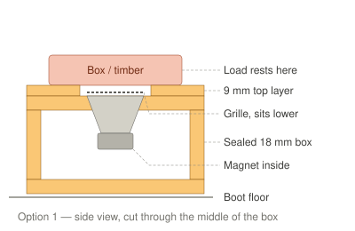
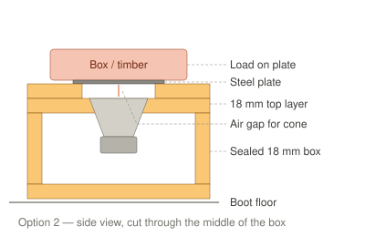
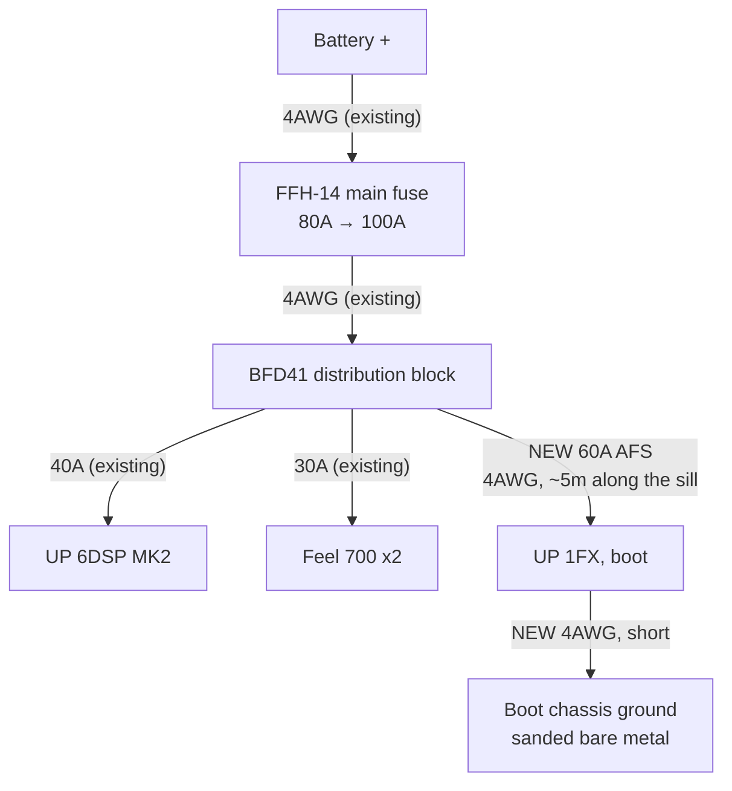
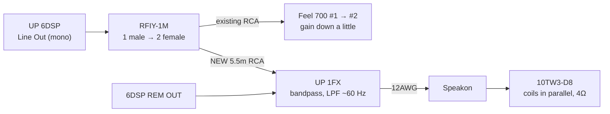

# Boot subwoofer — build plan

**Status: planned, parts not bought.** One JL Audio 10TW3 in a custom sealed box that replaces the
boot compartment, driven by a Match UP 1FX. The two Feel 700s stay under the front seats.

Hard constraints: **stealthy** (looks like a carpeted boot floor), **not in the way** (the rear seats
still fold and the boot still takes shopping, boxes and timber), and the **tools underneath stay
reachable without tools**.

## The plan in one picture

| Job | Sub | Plays |
|---|---|---|
| Deep bass | JL 10TW3-D8, boot | ~25–60 Hz |
| Upper bass and punch | 2x Feel 700, under the front seats, gain turned down a little | ~40–90 Hz |
| Midbass up | MW4 kick panels | 90 Hz up (unchanged) |

The Feel 700s only reach down to 40 Hz (Harman spec sheet), so the 10" takes the octave they
can't play. Both subs share one DSP channel — see [Signal](#signal).

## The space

The boot has a lidded compartment with toggle latches, fitted by a previous owner. It isn't used,
so the box replaces it. The tools (jack, wheel brace, small bag) sit underneath.

| Compartment closed | Compartment open |
|---|---|
|  |  |

| Measurement | Value |
|---|---|
| Internal height (floor to underside of lid) | **~10 cm** |
| Front to back | **~30 cm** |
| Width | **at least ~73 cm** (the tape ran past 75 cm along the sill) |
| Top of the lid to the top of the folded-up rear seat | **~43 cm** |

## Ruled out

- **Kicker HS12 on the back of a rear seat** — over 8 cm thick, and with 43 cm from the lid to the
  seat top it only fits if the compartment comes out anyway.
- **10" subs under the front seats** in place of the Feel 700s — keeping them is cheaper and they
  still do the upper bass.
- **12"** — the frame alone is ~33 cm across; it can't fit 30 cm front to back.
- **Ported box** — needs more air than the space has.
- **Amp inside the box** — eats volume, and the box would need its power unplugged to lift out.

**Fallback if the box build stalls:** a [Kicker HS10](https://caraudiocentre.co.uk/products/kicker-ka51hs10-hs-10-hideaway-compact-powered-loaded-enclosure)
(£399.95, special order, 3–5 days) dropped into the existing compartment. 250 × 84 × 368 mm, so it
clears the 10 cm height; the perforated lid lets the bass out. Same class as a Feel 700 (180W RMS),
so more output but not deeper — the custom box is the real upgrade.

---

## The sub

**JL Audio 10TW3-D8** — dual 8Ω coils, wired in parallel to **4Ω**.

| Spec | Value |
|---|---|
| Power | 400W RMS |
| Overall diameter, across the tab ears | **284 mm** |
| Diameter between the tab ears | 267 mm |
| Cutout | **244 mm** |
| Mounting depth (from the top of the baffle) | **83 mm** |
| Clearance needed behind the magnet | 6 mm |
| Xmax | 15.2 mm one way |
| JL sealed box | 16.3 L net (0.575 cu ft) |

**Why the D8 and not the D4:** at 4Ω the UP 1FX gives **350W** — just under the sub's 400W rating.
The D4 wired to 2Ω would get 600W, over the sub's rating, so the gain would have to be held back.
Use flat-head screws on the tab ears, not countersunk — JL warn countersunk screws can crack them.

## The box

**Height.** Mounting depth is measured from the **top** of the baffle, so the magnet hangs
83 − 18 = 65 mm into the box. Add the 6 mm clearance and the minimum inside height is **71 mm**,
or **107 mm** outside with 18 mm top and bottom. The plan uses **115 mm outside** (79 mm inside)
for more air and a 14 mm gap under the magnet.

**Volume.** Wider and taller is better; JL's figure is 16.3 L. Net figures below allow for the sub
(0.54 L) and one 18 × 50 mm brace. 30 cm front to back, 18 mm MDF:

| Outside width × height | Inside | Net air |
|---|---|---|
| 730 × 107 mm (minimum height) | 694 × 264 × 71 mm | 12.2 L |
| **730 × 115 mm (plan)** | **694 × 264 × 79 mm** | **13.7 L** |
| 730 × 125 mm | 694 × 264 × 89 mm | 15.5 L |
| 650 × 115 mm (if the tools need a bay) | 614 × 264 × 79 mm | 12.0 L |

Under 16.3 L the bass gets a little less deep and a little punchier. The Jimny's tiny cabin boosts
the lowest notes, which makes up for much of that. **Don't go under ~12 L.**

**Layout.**

- **Sub up-firing**, centred front to back, ~200 mm in from one end. The tab ears land 8 mm from
  the front and back edges, so the 30 cm depth is used to the millimetre.
- **Brace** — one strip of 18 mm MDF across the inside of the top panel, clear of the magnet, so the
  73 cm span doesn't flex.
- **Speakon socket** on the end panel away from the sub: it's the box's terminal *and* its
  quick-disconnect.
- **Joints** — glue and screw every joint, pilot holes first (MDF splits), silicone along every
  inside seam. Foam strip under the sub's flange as a gasket.
- **Carpet** the outside, spray adhesive, wrap the edges under.

### Protecting the sub

Shopping, boxes and timber go on top, so the grille must sit below the load surface.

**Option 1 — recessed grille (preferred).** A 9 mm MDF layer on top with a larger hole; the JL
grille sits below it. Adds ~1 cm (125 mm total).

**Option 2 — perforated steel plate.** The plate spans the hole and takes the load. The cone moves
~15 mm up at full volume, so the top layer must be **~18 mm** to leave an air gap. Adds ~2 cm.

### Cutting the 244 mm hole

- **Mark it:** strip of scrap wood, screw through one end at the centre, pencil hole 122 mm away,
  swing it round.
- **Cut it:** jigsaw — drill a starter hole inside the line and follow it slowly. Or the multi-tool,
  short overlapping plunge cuts just inside the line, then sand back.
- **Cut small, sand up** until the sub drops in. Practise on an offcut, test-fit before gluing.

---

## Quick release

No tools needed to reach the jack: **undo two latches, unplug one connector, lift the box out.**

- **Seat side — pegs into a floor angle.** A steel angle bolts to the floor through the old
  compartment's bolt holes. Two short bolts sticking out of the box's seat-side face drop into
  holes in its upright. This stops the box sliding toward the seats under braking and stops that
  edge lifting.
- **Tailgate side — toggle latches.** **Reuse the compartment's own latches** — they're already
  bolted to the floor brackets. Screw new catch plates to the box's tailgate face. Spare latches
  listed below in case the old ones don't line up.
- **Anti-rattle** — foam strip on the angle and under the box. A 10" pushes enough air to buzz any
  hard contact.
- **Amp stays in the car.** Only the speaker lead crosses to the box, through the Speakon — a
  locking connector rated 40A, so it can't shake loose.

The latches and pegs together are what hold the box in a crash, so the floor angle must be steel,
bolted, not screwed into trim.

---

## Amp

**[Match UP 1FX](https://www.cen.uk/products/match-up-1fx-amp-mono-1-channel-subwoofer-amplifier-class-d-900w-rms-at-1-ohms)**
— Match's mono sub amp, £259.99 at CEN, in stock.

| Spec | Value |
|---|---|
| Power | **350W @ 4Ω**, 600W @ 2Ω, 900W @ 1Ω |
| Inputs | 1x RCA (0.5–3V or 1–6V), 2x high-level, REM in |
| Filters | Low-pass **50–250 Hz** (12 dB, bandpass mode), 15 Hz subsonic |
| Phase switch | **None** — flip polarity by swapping the speaker leads |
| Current | 60A RMS max at 12V; internal 2x 30A |
| Size | 46 × 130 × 153 mm |

**Why not the M 2.1AMP** (the earlier pick): no UK stockist found, and it has **no low-pass
filter**, so the 10" and the Feel 700s couldn't be split into deep and upper bass. The UP 1FX's
own low-pass does that split.

**Where it goes:** fixed to the body in the boot, not on the box — dry, with air around it, close
enough that the speaker lead to the Speakon is short. Check behind the mounting surface for
cables and the fuel tank before drilling.

---

## Power

Uses a **spare output on the existing BFD41**. The BFD41 has four outputs (one 2AWG, three 4AWG)
and only two are used — amp and sub branches.

| Device | Max draw | Branch fuse |
|---|---|---|
| Match UP 6DSP | 35A | 40A (existing) |
| Feel 700 x2 | 28A | 30A (existing) |
| **Match UP 1FX** | **60A** (manual), ~30A at 350W into 4Ω (estimate) | **60A, new** |
| **Worst case on paper** | **123A** | main **80A → 100A** |

- **Main fuse up to 100A.** The 63A worst case today sits on an 80A main; adding the UP 1FX takes
  the paper maximum past it. Real music draw is far lower than the maxima, but 80A would be the
  first thing to blow. The FFH-14 takes AFS fuses up to 300A and the main run is 4AWG.
- **Alternator is 75A** (DENSO DAN1007). Fine for listening with the engine running. Watch for
  lights dimming on heavy bass — if they do, the Big 3 is the next step, not a new alternator.
- **Wire: 4AWG OFC, both power and ground.** Match recommend 25–35 mm² for runs over 1 m at full
  power; 4AWG is ~21 mm². At 4Ω the amp draws about half its maximum, so 4AWG is comfortable over
  ~5 m. It also lands straight in the BFD41's 4AWG port with no adapter.
- **Ground** — its own short 4AWG to sanded bare metal in the boot, ring terminal, star washer.
  Not shared with the front ground.
- **Re-do the voltage-drop test** afterwards with everything playing hard: under 0.2V from each
  amp's ground to battery negative.

---

## Signal

The UP 6DSP has **one** line out, already feeding the Feel 700s. All seven DSP channels are used,
so the boot sub **shares** that output — no separate DSP EQ or time delay for it.

- **Split at the amp, not under the seats.** The RFIY-1M plugs into Line Out; the existing Feel 700
  RCA goes in one side, the new 5.5 m RCA in the other. One lead of each RCA is used, as now.
- **Remote:** a new ~1 mm² run from the 6DSP's REM OUT, alongside the power wire.
- **URC.3** keeps working — it sets Line Out level, so it turns both subs up and down together.
- **Speaker lead:** 12AWG from the UP 1FX to the Speakon cable plug. Inside the box, short leads
  from the Speakon socket to the sub, both coils joined + to +, − to − (parallel, 4Ω).

### Tuning

| Where | Setting |
|---|---|
| DSP Line Out I | High-pass 30 → **25 Hz**, low-pass **90 Hz** (unchanged) |
| UP 1FX | Bandpass mode, low-pass **~60 Hz**, gain from low |
| Feel 700s | Gain down a little; LPF and bass boost as now |

1. **Gain first:** UP 1FX gain at minimum, RCA range jumper on 0.5–3V (the line out is 3V). Bring it
   up until the 10" just matches the Feel 700s.
2. **Polarity:** no phase switch, so play a 40–60 Hz tone from the driver's seat, then swap the two
   speaker wires at the amp and play it again. Keep whichever is **louder**.
3. **Rattles:** play a slow 25–80 Hz sweep parked. Expect the tailgate card, number plate, rear
   quarter trims and the dropped clip nuts in the kick panels. Deadening squares and felt tape.

---

## Parts list

Prices checked October 2026. **~** = price not shown on the page. Wire lengths are estimates —
run a string along the route before ordering.

### Sub and amp

| Item | Qty | Price |
|---|---|---|
| [JL Audio 10TW3-D8 — Audio Visual World](https://audiovisualworld.co.uk/jl-audio-10tw3-d8-shallow-mount-10-dual-8-ohm-car-subwoofer.html) — in stock | 1 | £399.99 |
| [JL Audio SGR-10TW3 grille — Car Audio Direct](https://caraudiodirect.co.uk/products/jl-audio-sgr-10tw3-10-black-steel-mesh-grille-insert) (option 1) | 1 | £39.90 |
| [Match UP 1FX — CEN](https://www.cen.uk/products/match-up-1fx-amp-mono-1-channel-subwoofer-amplifier-class-d-900w-rms-at-1-ohms) — in stock. Also [Dav-Tec](https://dav-tec.co.uk/product/match-up-1fx-amp-mono-1-channel-subwoofer-amplifier-class-d-900w-rms-at-1-ohms/) £259.00 | 1 | £259.99 |

### Power

| Item | Qty | Price |
|---|---|---|
| [Powerbass XWS-4P 4AWG power, 100% OFC](https://caraudiodirect.co.uk/products/powerbass-xws-4p-4-gauge-power-wire-100-ofc-wire-per-meter) — BFD41 → boot | ~5m @ £10.99 | £54.95 |
| [Powerbass XWS-4G 4AWG ground, 100% OFC](https://caraudiodirect.co.uk/products/powerbass-xws-4g-4-gauge-power-wire-100-ofc-wire-per-meter) — amp → boot chassis | 1m | £10.99 |
| [Connection SFA-060 60A AFS](https://caraudiodirect.co.uk/products/connection-by-audison-sfa-060-60a-afs-fuses) — new BFD41 branch | 1 | £7.99 |
| [Connection SFA-100 100A AFS](https://caraudiodirect.co.uk/products/connection-by-audison-sfa-100-100a-afs-fuses) — replaces the 80A main | 1 | £7.99 |
| [Vibe CLRT4-V7 4AWG ring terminals, pair](https://caraudiodirect.co.uk/products/vibe-clrt4-v7-critical-link-4-awg-ring-terminal-pair) — ground end | 1 | £4.99 |

### Signal and speaker

| Item | Qty | Price |
|---|---|---|
| [Rockford Fosgate RFIY-1M Y-adapter, 1 male → 2 female](https://caraudiodirect.co.uk/products/rfiy-1m-twisted-pair-y-adapter-1-male-to-2-female) — at Line Out | 1 | £9.99 |
| [Connection FT2-550.2 5.5m RCA](https://caraudiodirect.co.uk/products/connection-ft2-550-2-5-5m-rca-cable) — amp → boot | 1 | £15.99 |
| [Connection SL212.2 12AWG speaker cable](https://caraudiodirect.co.uk/products/connection-by-audison-sl212-2-silver-series-high-resolution-12-gauge-speaker-cable-per-metre) — UP 1FX → Speakon, plus inside the box | ~2m @ £5.50 | £11.00 |
| [Neutrik NL4MPXX Speakon panel socket — RS](https://uk.rs-online.com/web/p/speaker-connectors/0464690) — on the box | 1 | £3.70 |
| [Neutrik NL4FXX-W-S Speakon cable plug — RS](https://uk.rs-online.com/web/p/speaker-connectors/2843472) | 1 | £7.12 |
| ~1 mm² hook-up wire, REM OUT → UP 1FX — **already owned** (check there's ~5m) | — | — |

### Box and mounting

| Item | Qty | Price |
|---|---|---|
| 18 mm MDF — **already owned** | — | — |
| [Wickes 9 mm MDF, 606 × 1220 mm](https://www.wickes.co.uk/General-Purpose-MDF-Sheet---9-x-606-x-1220mm/p/110512) — option 1 top layer | 1 | ~ |
| [Gorilla PVA Wood Glue 236ml — Screwfix](https://www.screwfix.com/p/gorilla-glue-wood-glue-236ml/43424) | 1 | £7.69 |
| [TurboGold woodscrew handy pack, 380 — Screwfix](https://www.screwfix.com/p/turbogold-pz-double-countersunk-woodscrew-handy-pack-380-pieces/459jj) — 4 × 40 mm for the box | 1 | £9.99 |
| [No Nonsense 101 silicone, clear 310ml — Screwfix](https://www.screwfix.com/p/no-nonsense-general-purpose-silicone-clear-310ml/35887) — inside seams | 1 | £4.79 |
| [ACV 30.1231-04 black carpet 70 × 140 cm — Car Audio Direct](https://caraudiodirect.co.uk/products/acv-30-1231-04-black-carpet-70cm-x-140cm) | 1 | £24.99 |
| [OB41 Fast Tack spray adhesive 500ml — Screwfix](https://www.screwfix.com/p/ob41-fast-tack-spray-adhesive-clear-500ml/524YE) — carpet; collect only, 18+ | 1 | £5.59 |
| [Stormguard self-adhesive foam strip, 2 × 7.5m — Screwfix](https://www.screwfix.com/p/stormguard-sureseal-3-self-adhesive-foam-draught-excluder-weatherstrips-black-7-5m-2-pack/493VV) — sub gasket, anti-rattle | 1 | £6.19 |
| [Rothley 30 × 30 × 3 mm steel angle, 1m — Wickes](https://www.wickes.co.uk/Rothley-30mm-Hot-Rolled-Steel-Angle---1m/p/188290) — seat-side floor angle | 1 | ~ |
| [Savigny stainless toggle latch, pack of 2 — RS](https://uk.rs-online.com/web/p/door-latches/1974154) — **only if** the old latches don't line up | (1) | (£26.08) |
| M6 bolts, nyloc nuts, washers for the pegs and floor angle — match the old compartment's bolts | — | ~ |

### Total

**≈ £894** for everything priced, plus the 9 mm MDF, steel angle and bolts. The sub and amp are
£700 of it.

---

## Order of work

1. **Remove the compartment.** Photograph as you go, keep every bolt — the floor angle and latches
   reuse the same points.
2. **Measure the bare space** — everything in [Open questions](#open-questions) in one go.
3. **Cut list** from those numbers; check the volume against the table above.
4. **Cardboard mock-up** at the exact outer size. Seats fold, tailgate closes, latches line up.
5. **Build the box** — glue, screw, seal, brace. Leak test (light inside, dark car; or press on the
   cone and it should return slowly).
6. **Power and signal** — main fuse swap, new branch, 4AWG along the sill, RCA and REM alongside.
   Power and RCA down opposite sides of the car if the trim allows, to keep noise out.
7. **Mount the amp**, fit the Speakon, carpet the box, fit the floor angle and latch catches.
8. **Tune** — gain, polarity, rattles, then the full sub level against the fronts.

Wear a dust mask when cutting MDF.

## Open questions

- [ ] Exact width wall to wall, and how high the box can go (top of the old lid is the reference)
- [ ] Do the tools sit **under the floor** (box lifts off them) or **inside the compartment**
      (they need a new home or a bay at one end — 650 mm box)?
- [ ] Bolt points and thread size of the old compartment
- [ ] Amp spot in the boot, and a bare-metal ground bolt near it
- [ ] Do the old latches line up with a box face 115–125 mm tall?
- [ ] Power route: BFD41 → boot along which sill, and its real length
